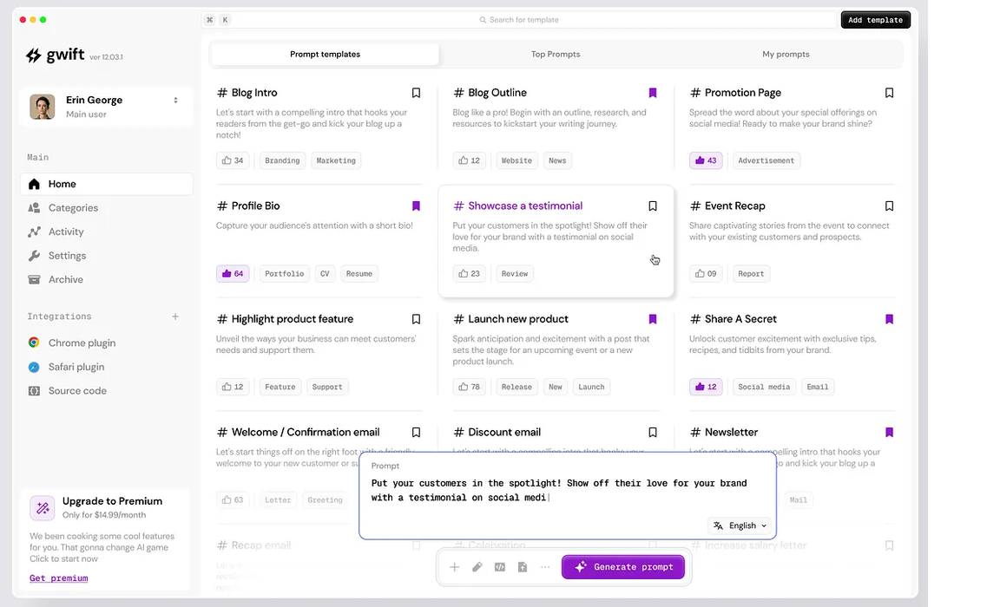
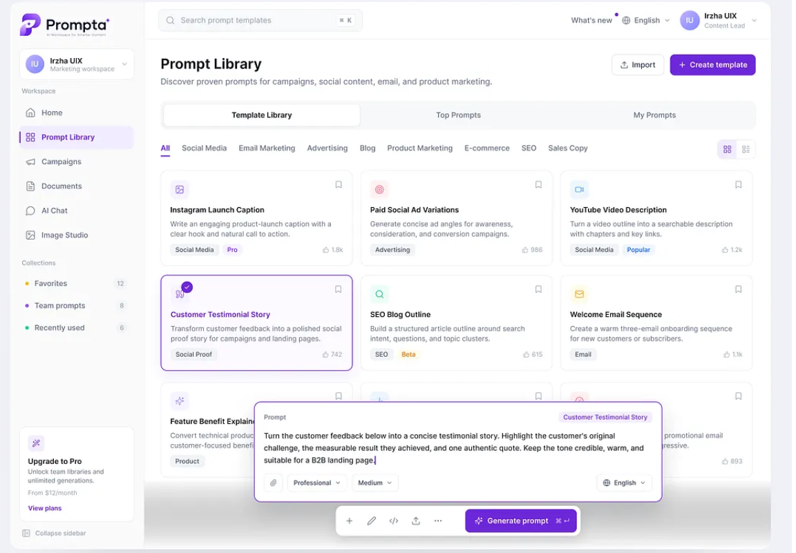
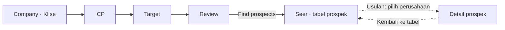

# Kliseer — Design Guide

Terakhir diperbarui: **4 November 2026**.

Pegangan desain UI/UX untuk FigCraft dan handoff frontend. **Acuan visual utama adalah dua gambar dalam folder `reference/` yang ditunjuk pengguna.** Dokumen ini menerjemahkan referensi tersebut ke kebutuhan Kliseer dan mencatat perbedaannya dengan file FigCraft yang sudah ada. Statusnya adalah **baseline desain**, belum persetujuan final untuk semua layar atau implementasi.

## 1. Sumber dan status

| Sumber | Dipakai untuk |
|---|---|
| [ref-1.png](reference/ref-1.png) — gwift | Workspace terang, hierarki teks, sidebar tenang, kartu ringan, dan composer dengan toolbar ringkas |
| [ref-2.png](reference/ref-2.png) — Prompta | Header halaman, kartu membulat, navigasi aktif lavender, selected state ungu, dan composer yang menonjol |
| [sidebar.png](reference/sidebar.png) — referensi sidebar | Sidebar menyatu dengan latar shell, ikon garis per menu, item aktif berupa bidang putih terangkat, pengelompokan menu |
| [Keputusan](docs/decisions.md), terutama D-01, D-12, D-15–D-23 | Nama, navigasi, alur, prioritas, dan keputusan pengguna |
| [Scope](docs/scope.md) | Segmen penjual dan prospek yang dilayani |
| [Brief FigCraft](docs/figcraft-prompt.md) | Rincian layar dan interaksi yang direncanakan |
| [Desain tersimpan](design/kliseer.figcraft) | Snapshot rancangan yang ada; pembanding implementasi terhadap referensi, bukan penentu akhir gaya visual |
| [Data demo](docs/demo.md) | Konteks seller dan contoh ICP; perhatikan status draft |
| [Pertanyaan terbuka](docs/open-questions.md) | Keputusan produk dan data yang belum selesai |

Gunakan tiga status saat membaca dokumen ini:

- **Disepakati:** keputusan pengguna yang sudah tercatat.
- **Teramati:** ciri yang terlihat pada gambar referensi atau nilai yang dibaca dari file FigCraft; asal pengamatan disebutkan. Keberadaan di canvas tidak otomatis berarti sudah disetujui.
- **Usulan:** detail kerja untuk melengkapi desain, masih dapat diubah saat review.

Urutan acuan: **instruksi pengguna terbaru → gambar dalam `reference/` untuk gaya visual → keputusan produk untuk fungsi dan alur → adaptasi dalam dokumen ini → snapshot FigCraft lama**. Referensi tidak mengganti delapan tab atau alur produk yang sudah diputuskan. Nilai ukuran dan warna yang diusulkan dari screenshot bukan spesifikasi resmi produk pada gambar. Beberapa butir lama di `open-questions.md` masih mendahului keputusan desain terbaru.

## 2. Produk dan pengguna

**Kliseer** adalah workspace pencarian prospek untuk supplier atau distributor material dan peralatan pekerjaan bangunan di Amerika Serikat.

Pengguna utamanya adalah **sales rep**, yaitu staf penjualan yang mencari calon pelanggan, memahami kebutuhan mereka, dan menentukan siapa yang layak dihubungi.

Pekerjaan utama pengguna:

1. Menjelaskan perusahaan dan produk yang dijual.
2. Menentukan ICP dan target pasar/prospek.
3. Memeriksa isian yang dibantu oleh chat.
4. Menemukan prospek, membaca alasan relevansi, dan memeriksa sumber pendukung.

ICP berarti **Ideal Customer Profile**: kriteria pelanggan yang cocok. Target mempersempit perusahaan, wilayah, dan peran pembeli yang ingin dicari. Target bukan kuota meeting per bulan.

Prospek mencakup general contractor, specialty trade contractor, system integrator bangunan, serta owner/developer yang membeli peralatan langsung. Pekerjaan sipil berat, pasar di luar AS, dan pengiriman outreach nyata berada di luar scope v1. Semua teks UI menggunakan **English**.

## 3. Arah visual

**Disepakati:** desktop-first dengan workspace terang, sidebar abu-abu muda, area kerja putih, dan aksen ungu. Tabel prospek tetap mudah dipindai, dengan ruang antarelemen yang mengikuti referensi.

### Pembacaan referensi

**ref-1:** sidebar sangat terang; judul gelap dengan deskripsi abu-abu; koleksi kartu tersusun dalam kolom dengan pemisah halus; satu kartu tampak terangkat; ungu muncul pada penanda, pilihan, dan tombol composer. Composer besar berada di bawah dengan toolbar terpisah. Pada gambar ini, navigasi aktif memakai bidang putih dengan border lembut.

**ref-2:** header utilitas tipis berada di atas judul/deskripsi dan aksi halaman. Sidebar aktif memakai latar lavender, ikon/teks ungu, dan penanda di kiri. Kartu memiliki sudut membulat, border ringan, ikon kecil berlatar pastel, dan label metadata. Kartu terpilih memiliki outline ungu, latar lavender yang sangat tipis, serta checkmark. Composer memiliki border ungu dan bayangan yang memisahkannya dari konten.

Kedua gambar adalah contoh **prompt-library workspace**. Adaptasi ke Kliseer mengambil hierarki, material, warna, dan pola kontrolnya; isi halaman tetap mengikuti pekerjaan sales rep. Logo, menu, akun, harga, paket upgrade, fitur template, dan angka dari referensi tidak menjadi requirement Kliseer.

### Penerapan ke Kliseer

| Pola dari referensi | Penerapan yang dituju |
|---|---|
| Shell abu-abu sangat muda dan workspace putih | Sidebar tenang, konten utama putih, pemisah tipis |
| Header utilitas → judul/deskripsi → aksi → filter → isi | Susun header Seer dan layar lain dalam lapisan yang mudah dipindai; search tetap kontekstual |
| Kartu dengan ruang internal dan sudut lembut | Ringkasan Review, metrik Seer, kelompok informasi, dan suggestion chips Home |
| Kartu aktif/terpilih dengan penanda ungu | Navigasi aktif mengikuti ref-2; gunakan border/fill/checkmark sesuai makna selected state |
| Ungu kuat pada aksi, lavender pada latar pilihan | CTA utama jelas, area besar tetap netral |
| Composer berbatas jelas dengan toolbar ringkas | Bentuk input chat mengikuti referensi, ditempatkan dalam konteks Home atau panel kanan |
| Ikon kecil konsisten dan metadata tenang | Ikon navigasi/control sederhana, badge sumber/status berukuran ringkas |

Pedoman kerja:

- Utamakan keterbacaan nama perusahaan, tier, alasan beli, dan sumber.
- Pakai ruang antarkelompok lebih besar daripada jarak isi di dalam satu kelompok. Kepadatan tabel tidak diterapkan ke seluruh halaman.
- Gunakan bentuk membulat secukupnya, border halus, dan bayangan ringan untuk menunjukkan elemen yang terangkat.
- Ungu menandai aksi utama, pilihan aktif, dan fokus; status tetap memiliki label teks.
- Gunakan font sans-serif yang konsisten. Identitas font pada screenshot belum diketahui; jangan mengklaim Inter sebagai font asli referensi.
- Warna solid menjadi baseline. Kilau/gradient kecil yang tampak pada tombol atau logo referensi bersifat opsional; area kerja tetap tenang tanpa gradient besar.
- Tampilkan kekosongan dan kegagalan dengan pesan yang menjelaskan langkah berikutnya.

Koreksi terhadap versi awal: **batas radius 6 px untuk semua elemen dicabut**. Radius, elevasi, dan spacing dibedakan menurut fungsi komponen agar sesuai bentuk panel/kartu yang terlihat pada kedua referensi.

## 4. Navigasi dan layout

### Delapan tab

Urutan sidebar **disepakati** dan tetap sama di seluruh layar.

| Tab | Fungsi | Prioritas desain |
|---|---|---|
| Home | Chat global dan history percakapan yang dikelompokkan per tab | Frame dasar |
| Klise | Background perusahaan; menjadi langkah Company saat setup | Rinci |
| Target | Jenis perusahaan, wilayah, dan peran pembeli yang dicari | Rinci |
| Seer | Tabel prospek dan detail prospek | Rinci |
| Signals | Catatan sinyal, sumber, dan tanggal | Frame dasar |
| Competitors | Daftar atau tabel kompetitor | Frame dasar |
| Profiling | Daftar atau tampilan profil perusahaan | Frame dasar |
| ICP | Kriteria pelanggan ideal | Rinci |

Nama produk selalu **Kliseer**. **Klise** dan **Seer** adalah label tab. Judul isi halaman boleh menjelaskan fungsinya, misalnya `Company background` dan `Prospects`.

**Aset logo resmi — dipilih user 7 November 2026:** gunakan `logo-concepts/kliseer-lockup.svg` untuk ikon + tulisan, `logo-concepts/kliseer-icon.svg` untuk ikon saja, dan `logo-concepts/kliseer-wordmark.svg` untuk tulisan saja. Impor SVG asli; jangan menggambar ulang simbol dengan huruf `K` atau mengetik ulang wordmark. Pertahankan proporsi, warna, dan bentuk sudut aset; avatar tidak boleh memotong ikon menjadi lingkaran.

Di FigCraft, ketiganya tersedia sebagai komponen vektor `brand/lockup`, `brand/icon`, dan `brand/wordmark` di halaman Components. Lockup diterapkan ke seluruh 36 sidebar Screens/Q20; ikon menggantikan identitas assistant pada Home, chat kontekstual, dan master `chat/message` beserta instance-nya. Tidak ada penempatan wordmark-only pada layar saat ini; master-nya disiapkan dari aset resmi, bukan varian baru. Aset sumber tidak diubah. Perubahan ini pada dokumen desain dan export, belum frontend.

### Shell desktop

Ukuran kerja **teramati dari file FigCraft saat ini** (direvisi 4 November 2026), frame **1440 × 900 px**:

| Area | Lebar | Catatan |
|---|---:|---|
| Shell | 1440 px | Latar `#F2F2F4`, padding 8 px, gap antarpanel 8 px |
| Sidebar | 212 px | Menyatu dengan latar shell, tanpa panel sendiri |
| Workspace utama | ±878 px (fill) | Panel putih, radius 12, border `#E5E7EB`, `shadow.surface` |
| Chat kontekstual | 322 px | Panel putih yang sama dengan workspace |

Workspace terdiri dari topbar 52 px (breadcrumb kiri, feedback simpan kanan), konten dengan padding 28/32 px, dan footer aksi 68 px pada layar setup. Form setup dibatasi lebar 640 px. Angka ini titik awal implementasi, bukan kewajiban koordinat absolut.

**Sidebar (mengikuti `reference/sidebar.png`):** gunakan instance `brand/lockup` dari `kliseer-lockup.svg`, dengan simbol tampak 28 px; `Home` berdiri sendiri, tab lain di bawah label `Workspace`. Item 34 px dengan ikon garis 16 px. Item aktif berupa bidang putih, border tipis, shadow kecil, ikon ungu, dan teks Semi Bold. Selama setup, widget `Getting started` menggantikan kartu `Setup N of 4` lama. Navigasi aktif tetap mengikuti referensi sidebar, bukan lavender ref-2.

**Getting started — revisi user 7 November 2026:** styling mengikuti screenshot checklist dan `reference/setup.txt`, diadaptasi ke lebar sidebar 196 px. Header menampilkan chevron, judul, 14 batang vertikal, dan counter selesai `/4` dalam satu baris. Kartu putih, radius 12 px, border tipis, shadow lembut. Progress hijau memakai variable `setup/progress-complete` (`#22C55E`); lingkaran selesai memakai `status/success` agar checkmark putih terbaca. Tidak ada perubahan pada stepper di konten utama.

Komponen set `setup/progress` memiliki `Stage=Company/ICP/Target/Review/ReviewNeedsInput` dan `Expanded=False/True` (10 varian). Ukuran collapsed 196 × 52 px; expanded 196 × 260 px. Terpasang pada 23 sidebar setup/Q20, termasuk upload. Instance dan wrapper mengikuti tinggi konten; spacer sidebar menyusut saat dibuka, sehingga widget mengembang ke atas dan tetap berjarak sama dari bawah. Semua frame tersimpan collapsed seperti default kode referensi.

Checklist tetap empat langkah Kliseer: Company → ICP → Target → Review. Langkah selesai memakai check hijau, langkah aktif nomor gelap, langkah mendatang nomor outline dan tidak memiliki navigasi. Langkah selesai dapat dibuka kembali. Counter menunjukkan langkah sebelumnya yang selesai, bukan nomor langkah aktif atau approval: Company `0/4`, ICP `1/4`, Target `2/4`, Review `3/4`. Review incomplete memakai `ReviewNeedsInput`: Company selesai, ICP aktif/perlu diperbaiki, Target dan Review belum selesai (`1/4`); tidak menampilkan check palsu pada ICP.

Header memiliki interaksi prototipe `changeTo` collapsed ↔ expanded dengan Smart Animate 200 ms. Geometri collapsed dan expanded diuji melalui pergantian properti instance dalam shell Target; tinggi expanded 260 px dan posisi sidebar y=612 menjaga batas bawah y=872. Render dan export diperiksa. Belum diuji dengan klik presenter dan belum implementasi React/Motion. Preview expanded: `design/export/setup-getting-started-expanded.png`.

**Adaptasi referensi:** kedua gambar memperlihatkan sidebar kiri dan area konten luas. Kliseer menambahkan panel chat kanan sesuai keputusan produk. Pertahankan rasa lapang melalui padding, hierarki header, dan lebar konten yang fleksibel. Untuk halaman yang membutuhkan pencarian, tempatkan kontrol itu pada header/toolbar tipis; judul dan aksi halaman mendapat baris sendiri. Ini pola penataan, bukan keputusan menambahkan global search atau menu akun baru.

Tiap tab selain Home memiliki satu thread chat kontekstual di kanan, dengan nama seperti `Klise chat` atau `Seer chat`. Home memakai chat global sebagai isi utama dan history per tab; tidak perlu menduplikasi chat di panel kanan.

**Usulan perilaku layout:** workspace mengisi ruang yang tersedia, pesan chat memiliki area scroll sendiri, dan composer tetap mudah dijangkau. Tabel lebar boleh memiliki scroll horizontal di dalam area tabel. Jangan mengecilkan teks untuk memaksakan semua kolom masuk. Adaptasi tablet/mobile dan breakpoint belum ditentukan.

## 5. Alur utama

**Disepakati:** pengguna baru langsung masuk ke Company. Satu langkah ditampilkan per layar, dengan progres dan akses kembali ke langkah yang sudah selesai.

Sidebar tetap terlihat selama setup. Company, ICP, dan Target memakai tab yang sudah ada. Review adalah langkah setup, bukan tab kesembilan.

### Company / Klise

Field dari brief: `Company name`, `Website`, `Products and services`, `Customer segments`, `Existing customers`, `Region`, dan `Price range`.

Tampilkan form yang bisa diedit berdampingan dengan chat. Siapkan contoh kosong, terisi draft, dan tersimpan. Aksi lanjut: `Continue to ICP`. Aturan field wajib dan validasi bisnis belum final; jangan menetapkan semua field sebagai wajib hanya karena tercantum di layout.

**Upload — frame5 multi-file disetujui user 7 November 2026:** keempat frame lama dipakai di tempat: `setup/company/empty`2238, `klise/upload/parsing`6456, `klise/upload/draft`6598, `klise/upload/error`6740. Tidak menambah Screens atau mengubah sidebar, logo, chat shell, dan stepper. Referensi tersimpan di `reference/upload-multiple-files.png`. Warna terang Kliseer dipertahankan; bukan menyalin tema gelap Tryclean.

- Tombol **Upload files**, area drag-and-drop, dan tabel808 px dengan kolom Name / Status / Size / Action. Bisa memilih beberapa file sekaligus; contoh3 file bukan batas jumlah file. PDF/MD/TXT, **2 MB per file** (2 MiB dari kontrak upload lama). Tidak menambah DOCX, meter storage1GB, tanggal uploaded, atau penyimpanan file asli. Jumlah maksimum/total batch belum ditetapkan; UI tidak menjanjikan unlimited.
- Component set `klise/upload-files`10611 memiliki5 varian: Empty10486, Parsing10495, Ready10525, PartialError10555, TwoReady10586. Empat screen memakai instance. Empty memiliki dropzone besar dan study-case action hanya di Company kosong. Tombol Upload files tetap tersedia setelah batch selesai; memilih file/drop di prototipe membuka contoh batch, bukan file picker nyata.
- Parsing: dua file Ready, satu Reading…, tanpa persentase rekaan. Hasil dari dua file siap tetap ada, diredupkan selama membaca; Continue nonaktif. Ready berarti file selesai dibaca, bukan approved. Panel Parsing dan footer memakai plural files. Delay2.2 detik ke draft masih simulasi.
- Draft: contoh seller fiktif Harborline berlabel ilustratif,3 file menghasilkan4 field Company. **F1 company-overview.md**4KB → Company name dan Region; **F2 product-catalog.pdf**88KB → Products and services; **F3 sales-notes.txt**2KB → Customer segments. Setiap nilai memiliki kutipan literal dan label nama file/F-ID. Website, existing customers, price range tetap kosong. Tidak ada auto-approve. Teks fixture sumber disimpan pada pluginData komponen untuk memeriksa kutipan; bukan dokumen yang benar-benar diupload.
- PartialError menggantikan error global lama: F1/F2 Ready, F3 Error dengan teks persis **Could not read that file.**. Choose again hanya untuk file gagal; Remove mengganti panel menjadi TwoReady. Tiga field dari F1/F2 dipertahankan, Customer segments tanpa nilai/kutipan karena F3 gagal. Menghapus file gagal tidak menghapus atau menyetujui draft lain. Prototipe belum menentukan aturan konflik antarfile atau menimpa edit manual.
- Retention tetap: file asli tidak disimpan. Yang disimpan nanti nilai ekstraksi dan kutipan beserta atribusi file. Panel bukan perpustakaan dokumen persisten. View quotes → field, label sumber → row file terkait. Viewport content vertical-scroll dengan inner document, footer Continue tetap di luar scroll; panel tabel dan draft tidak harus muat seluruhnya pada viewport awal.
- Verifikasi: render4 screen, partial failure, failed-file-removed, draft bagian bawah, dan field lengkap diperiksa. Smoke instance PartialError → TwoReady membuktikan jumlah row3→2 dan seluruh teks draft sukses tetap identik; dikembalikan PartialError. Empat kutipan cocok literal dengan fixture F1/F2/F3. Tiga row per status3-file diperiksa: Ready/Ready/Reading, Ready×3, Ready/Ready/Error. Scroll bottom diekspor memakai offset visual sementara lalu y28 dipulihkan. Belum menguji klik presenter, drag/drop, multi-file picker, parser, atau persistence runtime; tidak ada perubahan kode aplikasi.
- **Kontrak development dari desain approved:** picker harus menerima multiple files dan dropzone menerima beberapa file, bukan memproses file pertama saja. Validasi2MiB dan status/error berlaku per file; kegagalan satu file tidak membatalkan batch sukses. Retry/removal file gagal tidak menghapus draft lain. Simpan filename bersama setiap kutipan literal; hasil tetap draft dan original tidak dipersist. Helper `readUpload`/`proposeCitations` adalah operasi per file yang perlu diorkestrasi, bukan bukti multi-file UI sudah diimplementasikan. Uji acceptance dengan minimal2 file sukses +1 gagal, lalu retry/remove sambil memastikan hasil sukses dan edit user tidak hilang. Aturan konflik antarfile dan batas total batch harus ditetapkan eksplisit saat implementasi, bukan ditebak dari contoh3 file.

### ICP

Kriteria dari brief: industry, company size, region, dan event types. Tampilkan nilai dan statusnya secara jelas. Aksi lanjut menuju Target. Hindari membuat ICP dan Target terasa sebagai dua form identik: ICP menjelaskan kecocokan pelanggan, Target menentukan fokus pencarian.

### Target

Field dari brief: target company types, regions, dan buyer roles. Aksi lanjut menuju Review. Tidak ada langkah Goals terpisah atau field meeting bulanan.

### Review

**Disepakati:** pengguna memeriksa dan menyetujui draft sebelum aksi `Find prospects` membuka Seer.

**Usulan layout, Q20 belum final, sudah dirancang di canvas:** tiga kartu Company, ICP, dan Target, masing-masing berisi tiga field kunci, badge status (`Approved`, `Draft`, `Needs input`), dan link `Edit` di header kartu yang membuka langkah terkait. Bagian berstatus `Draft` memiliki tombol `Approve`. `Find prospects` nonaktif sampai ketiga bagian approved, dengan status tertulis di footer (`2 sections need review`). Field wajib yang kosong tampil merah dengan instruksi singkat. Review hanya menampilkan field kunci; detail lengkap dibuka lewat `Edit`.

### Seer / tabel prospek

**Frame 6 — direvisi via FigCraft MCP 7 November 2026, menunggu review:** `seer/table/{ready,loading,empty,error}` diperbarui pada frame lama, plus `filtered-empty` agar pencarian kosong tetap berbeda dari belum ada hasil. Shell, logo resmi, sidebar, dan panel Seer chat dipertahankan. Ini desain, belum perubahan frontend/backend.

Frame 6 masih memakai snapshot ilustratif lama: 20 baris, kolom `Fit*` 96–77, tiga faktor teks, dan tanpa tier. **Ini bukan kontrak scoring terbaru.** G8/G9 sekarang menetapkan empat rating 0–5, total 0–20, dan tier deterministik; revisi ini diterapkan pada detail frame 7–9. Migrasi tampilan tabel frame 6 belum menjadi scope permintaan revisi ini.

Tabel memakai komponen `seer/prospect-row` (id `8425`), dengan properti teks Rank, Company, Location, Score, Evidence, Date. Ada tepat 20 instance. Viewport 806 × 432 px memuat enam baris 72 px; konten 20 baris setinggi 1440 px memakai overflow vertical. Header dan footer gate berada di luar scroll. CTA terbaru yang diminta user: `Upgrade to view all`; seluruh teks UI memakai English. Gate UI saja, tanpa billing atau angka total tersembunyi rekaan.

**Data contoh:** 20 nama perusahaan berbeda, tanggal, dan bukti berasal dari record publik NYC DOB electrical permits, endpoint `https://data.cityofnewyork.us/resource/dm9a-ab7w.json`, dibaca 7 November 2026. Dipilih record terkait generator, transformer, panel, service switch, dan peralatan listrik; ini kurasi ilustratif, bukan top 20 terverifikasi untuk seller. Tiap instance menyimpan `sourceUrl`, `sourceRecordId`, kutipan asli penuh, dan status skor ilustratif pada pluginData. Teks Evidence adalah ringkasan singkat, bukan kutipan verbatim. Source membuka record dengan query `?job_filing_number=<id>`. Tidak ada domain, kontak, source count, atau confidence rekaan. Data tersebut bukan pengisian 10 kontak guest Q12; mode guest tetap keputusan terpisah.

State loading menunjukkan `Loading matches…` dan skeleton; hanya membaca saved matches dari DB, bukan progres request per sumber. Ingest terjadwal 06:00 UTC dicantumkan sebagai jadwal, bukan klaim data baru saja berhasil diperbarui. Empty menjelaskan belum ada hasil dan menawarkan `Edit target`. Error memakai `Could not load prospects.` dengan `Retry`, tanpa menghapus setup. Filtered-empty menampilkan pencarian tanpa hasil dan `Clear search`. Nilai hasil tidak diganti nol ketika loading/error.

Wiring: Retry → loading → ready setelah 1.6 detik (simulasi DB); Edit target → Target empty; Clear search → ready; 20 tautan Source membuka record masing-masing. Baris 20 menggunakan Hivolts dan membuka detail yang sesuai. Skor/urutan tabel tetap ilustratif. WCK dan A&S tersedia sebagai frame detail review, bukan tambahan baris baru. Search/sort serta gate belum runtime frontend.

Verifikasi: render kelima state desktop 1440 × 900 diperiksa; baris 15–20 diperiksa dengan offset visual konten sementara, diekspor ke `seer-table-ready-bottom.png`, lalu posisi awal dikembalikan ke y=0 sebelum save. Smoke struktur MCP memastikan 20 instance, 20 source record unik, 20 aksi Source, dan tidak ada teks tier/domain `.example`/perusahaan fiktif lama di kelima frame. Klik, scroll, search/sort dan gate belum diuji end-to-end di presenter/browser. Akses DB lokal untuk sampel timeout; data canvas diambil langsung dari endpoint publik, bukan hasil query DB yang diklaim berhasil.

### Seer / detail prospek

**Frame 7–9 — direvisi di tempat, bukan frame baru:** `seer/detail/ready` id `2097` sekarang WCK ELECTRIC CORP.; Hivolts `4701` dan A&S `8819` tetap ada. Shell, posisi frame, sidebar/logo, dan Seer chat dipertahankan. Jumlah Screens tetap 34. Loading/error yang menuju ready diperbarui ke WCK. Detail tetap scroll dalam workspace, bukan halaman email baru.

**Disetujui user 7 November 2026:** revisi frame 7–9 ini, termasuk empat rating bintang G8 + overall tier, contoh WCK 16/S (5/5/5/1), kontak terbatas pada 13 baris seed, dan state draft/contact-required. Approval ini untuk desain, bukan klaim implementasi frontend/backend atau approval perubahan frame 6.

Urutan: Back to prospects → nama/domain → navigasi bagian → **Analysis → Company profile → Contacts → Email draft → Sources**. Sources selalu bagian terakhir. Tombol navigasi dan citation IDs memiliki aksi scrollTo; source rows eksternal memiliki URL, sementara C5 research snapshot secara jujur menunjuk catatan internal, bukan URL verifikasi palsu.

**Analysis / frame 8 — G8 menggantikan spesifikasi tiga baris sebelumnya:** empat baris **Keyword, Freshness, Place, Target fit**, masing-masing lima ikon star vektor dengan bagian kosong berupa outline, angka `n / 5`, dan alasan singkat. Header memuat `Overall 16 / 20` + badge `Tier S`. Kartu 808 × 418 px; paragraf interpretasi dipisahkan dari rating, dengan catatan bahwa AI tidak menghitung skor. Snapshot read-only DB 7 Nov memverifikasi WCK (id `69623`), Hivolts (`69825`), dan A&S (`69767`) semuanya k=5/f=5/p=5/t=1, total 16, S. Target fit 1 karena seller target.companyTypes kosong; jangan menebak jenis perusahaan. WCK punya lima keyword-matching signals dalam 90 hari; filing terbaru Nov 5. Overall bukan bukti buying intent. A&S tetap diberi caveat permit Complete.

**Company profile:** tetap 15 field C5. WCK memakai firm/address dari DOB, 464 saved signals dan 5 keyword matches/90 hari dari DB; phone/email/website/decision maker yang tidak tersedia ditulis not found, bukan meminjam data Solas. Sources WCK memisahkan tiga URL permit nyata dari snapshot scoring dan seed internal. Profile Hivolts/A&S mempertahankan caveat count C5; nama orang di luar seed tidak dijadikan decision maker atau recipient.

**Contacts / frame 7:** hanya kontak dari 13 baris `scripts/seed-hunter-contacts.ts`, dicatat juga di `docs/sources.md` C6. WCK tidak punya seed row dan query kontak DB kosong: tampil no-contact, Phone: not found + link permit, ikon LinkedIn/web/social dicoret tanpa URL. Hivolts memakai Moishy Rosman dan company contact Hivolts Electrical; A&S memakai company contact A & S Electric Inc., bukan Francis. Komponen draft Solas hanya memakai Conor dengan `office@solasnyc.com`. Isaac, Francis, Yosef, dan `conor@` tidak dipakai sebagai kontak desain ini. Domain jobs@hivoltelectrical.com tetap mengikuti seed, tanpa koreksi diam-diam. Label Hunter tidak dinaikkan menjadi website-confirmed.

**Revisi kartu kontak (8 Nov):** komponen `seer/contact-card` (id `11055`, halaman Components) mengikuti referensi user: header avatar inisial + nama + menu, lalu baris Company → Job title → Email (jabatan di atas email; nomor telepon tidak lagi berupa baris teks), ikon LinkedIn/web/social, footer tombol Phone dan Email. Ikon tanpa URL tetap dicoret (Q17). Hivolts menampilkan dua kartu (Moishy Rosman, Hivolts Electrical), A&S satu kartu company contact; WCK tetap no-contact. Glyph social diganti ikon share-nodes karena glyph lama rusak. Ikon Source di `seer/prospect-row` diganti panah external-link yang utuh.

**LinkedIn, web, social (8 Nov):** component set `contact-link/linkedin`, `contact-link/web`, `contact-link/social`, masing-masing variant `State=Available` / `State=Unavailable`. LinkedIn Available = logo "in" biru (variable `brand/linkedin` `#0A66C2`), bisa diklik ke URL LinkedIn; Unavailable = logo outline abu + garis coret, latar subtle, tanpa interaksi. Web/social Available = glyph ungu; Unavailable = glyph abu + coret. Moishy: LinkedIn Available (URL profil yang dipakai `Open LinkedIn →`). Web Available untuk Hivolts (`hivoltselectrical.com`) dan A&S (`aselectricnyc.com`) sesuai kolom `site` seed. Social Unavailable untuk semua karena seed tidak punya URL social. WCK: ketiganya Unavailable. Frame `seer/detail/{loading,error,hivolts}` dipindah ke baris y=7000 karena sebelumnya menumpuk di atas `seer/table/{loading,empty,filtered-empty}`.

State `seer/contact-availability/phone-missing` (`9597`) tetap tersedia. WCK juga memakai state itu secara nyata di detail: Phone: not found + URL permit, tanpa klaim bahwa pencarian eksternal sudah dijalankan. Hivolts/A&S mempertahankan nomor first-party yang diketahui. Form manual LinkedIn empty/filled tetap memakai Moishy dari seed. Lookup: login wajib, Free maksimum 5/bulan, tanpa scraping/extension atau runtime Hunter/SerpAPI Free. Ini desain, bukan API lookup yang sudah tersambung.

**Email draft / frame 9:** 11 varian reusable lama tetap dipakai (Solas/Hivolts/A&S Empty, Generating, Saved; Hivolts NameChanged; Solas Guest), bukan menggambar layar baru. Hivolts Saved ↔ NameChanged sekarang **Moishy Rosman ↔ Hivolts Electrical** (jobs@hivoltelectrical.com); subject dan salam berubah nama saja, edit `We can work around your delivery schedule.` tetap. A&S memakai company contact/email seed, tanpa individual DM. Panel WCK id `9240` adalah override contact-required pada instance lama: tidak punya recipient, Generate disabled tanpa interaction; tidak meminjam kontak Solas. Hivolts/A&S default Empty. Generating delay tetap simulasi 1.8 detik. Input, clipboard, Save changes, auth, dan sending belum runtime.

**Verifikasi revisi G8:** render detail, empat star rows, profile, contacts, Sources dan draft diperiksa; clearance paragraf/footnote disesuaikan agar tidak bertumpuk. Smoke struktur: empat faktor × lima slot star per detail, filled 5/5/5/1, total16/S, 15 profile fields, Sources terakhir. Query read-only berhasil membaca scores, sumber WCK, count464/matched5, dan kontak WCK kosong; tidak menjalankan refresh/seed. Instance Hivolts Saved → NameChanged dibuktikan mengganti nama saja pada subject/body; delivery edit utuh, kemudian dipulihkan Empty. WCK Generate tidak punya interaction. Pencarian teks UI seluruh halaman tidak menemukan Yosef/Francis/Isaac/conor@. Belum menguji klik presenter, input, atau layanan frontend/backend.

### Landing / frame 1 — brief dan arah motion

Brief, copy English, alur empat tahap, referensi visual, dan choreography motion dipusatkan di **[design_landing.md](design_landing.md)**. Gunakan dokumen tersebut untuk pekerjaan landing; `DESIGN.md` tetap acuan token/brand dan desain aplikasi internal.

Status: brief tersedia, belum digambar di FigCraft atau diimplementasikan. CTA utama Explore Demo; headline kerja “Stop guessing. Start aiming.” Video ditunda. Jika landing menampilkan upload, pakai versi multi-file yang sudah approved (G13), bukan single-file lama. Keputusan produk tetap di `docs/decisions.md` G8–G13.

### Authentication / frame 2–3

**Dirancang via FigCraft MCP 7 November 2026, menunggu review user.** Landing diskip sesuai permintaan terbaru. Mode Operate: dua layar standalone, tanpa sidebar/chat atau panel marketing. Desktop 1440 × 900 memakai shell netral dan canvas putih radius12, form400 px terpusat horizontal, Inter, semantic tokens Kliseer, serta instance logo resmi `brand/lockup` yang diskalakan proporsional1.4×; tidak menggambar ulang wordmark.

Komponen `auth/form` id `10109` memiliki 10 varian Screen × State. Field dan tombol memakai instance `field/text` dan `button` yang sudah ada; indikator From chat disembunyikan khusus pada auth, tidak mengubah master setup. Auto-layout menggeser konten saat error muncul; field error, submitting/disabled, dan focus email ditampilkan.

| Screen | Frame utama | State desktop |
|---|---|---|
| Login | `auth/login/empty` (`10110`) | empty, filled (`10148`), submitting (`10186`), error (`10224`) |
| Create account | `auth/create-account/empty` (`10264`) | empty, filled (`10300`), invalid-email (`10336`), short-password (`10373`), error (`10410`), submitting (`10448`) |

**Login:** Email, Password, Log in, Explore Demo, link Create account. **Create account:** Email, Password, Create account, link Log in; tidak ada nama, Explore Demo, social auth, atau verifikasi email. Tombol utama disabled saat form kosong/submitting. Error generik kedua layar persis `Email or password is not valid.`; pada signup juga mewakili email sudah terdaftar. Validasi signup persis `Enter a valid email.` dan `Password must be at least 8 characters.`. Nilai email contoh `sales@example.com`, bukan credential akun nyata; password hanya mask.

**Prototype:** link Login ↔ Create account tersambung. Klik field pada review state memakai sample-state transition ke Filled (bukan input teks runtime). Filled dan retry generik menuju Submitting; delay1 detik menuju Home `5013`, dengan aksi session-label Log out. Explore Demo hanya pada Login menuju Home dengan label Log in. Enam flow starting points memudahkan review default/error/validation. Frame error dapat dibuka lewat flow review; prototipe tidak menghitung validasi atau memeriksa akun. Tidak mengimplementasikan session cookie, klaim guest, auth API, atau perubahan Basic Auth. Aturan G2 tetap kontrak implementasi.

**Verifikasi:** render desktop default, filled/focus, submitting, error generik, dan kedua validasi diperiksa; footer Login yang sempat wrap diperbaiki. Smoke struktur atas10 frame memastikan dua field, tidak ada Demo pada signup, copy error tepat, indikator chat tidak terlihat, footer satu baris, Empty submit tanpa interaction, dan Submitting menuju Home. Instance Login dicoba Filled → Error → Empty untuk membuktikan varian/error dan pemulihan state default. Belum diuji dengan klik presenter atau autentikasi/input browser nyata. Export `auth-login-*.png`, `auth-create-account-*.png`, dan `auth-form-states.png` tersedia di `design/export/`.

### Layar pendukung

Home mengikuti Q9 dan frame 4 di `KLISEER_BUILD_PLAN_2.md`: chat global, history per tab, greeting, tiga kartu, empat aksi, dan composer bawah berdasarkan `reference/chat.png`, dengan warna dan font Kliseer. Signals menampilkan sinyal per sumber dan tanggal. Competitors dan Profiling tetap pada rancangan dasar D-23.

**Sudah dirancang di canvas (frame dasar, satu state `ready`/`empty`):**

- **Home — direvisi 7 November 2026 via FigCraft MCP:** frame lama `home/chat/empty` (id `5013`) tetap 1440 × 900 px; sidebar delapan tab tetap dipakai. Kolom history 216 px menampilkan `No conversations yet`, tanpa contoh thread atau seller bawaan. Area chat memiliki greeting terpusat, tiga kartu (assistant putih dengan border gradient ungu, tautan Company/ICP/Target, suggested prompt), empat aksi (`Company profile`, `Define ICP`, `Set targets`, `View prospects`), dan composer 844 × 116 px di bawah. Kartu assistant dan tombol `New chat` di kolom Chats memakai isi putih dan border gradient diagonal 1.5 px inside: `#5B21B6` → `#8B5CF6` → `#6D28D9` (posisi 0 / 0.5 / 1); judul kartu gelap, label dan ikon ungu. Treatment ini dipilih user; ukuran, posisi, copy, dan interaksi tetap. Tombol `New chat` di header tetap netral. Inter dan variable warna Kliseer dipakai; fitur Voice, Share, dan Calendar dari referensi tidak disalin. Collection `Session preview`, mode `Guest` / `User`, mengubah label shell menjadi `Log in` / `Log out` dalam frame yang sama; file disimpan pada mode Guest. Ini desain untuk review canvas, bukan implementasi chat/auth. Landing, login, Signals, Competitors, Profiling, dan stepper setup tidak diubah.
- **Signals:** tabel Date, Type (badge), Company, Signal, Source, dengan filter `All / Permits / Hiring / Contracts`. Filter ini usulan.
- **Competitors:** tabel Competitor + domain, Overlapping products, Regions, Positioning, Sources.
- **Profiling:** tabel Company + domain, Type, Employees, Location, Profile (`Complete` / `Partial`), Updated. Status `Partial` dan kolomnya usulan.

## 6. Chat dan draft terstruktur

**Disepakati:** chat mengusulkan nilai field; pengguna tetap memeriksa dan menyetujui hasilnya. Isian dari chat memiliki penanda yang mengarah ke pesan sumber.

**Usulan spesifikasi interaksi:**

- Composer mengambil bentuk dari kedua referensi: panel putih membulat, area ketik yang lega, border netral saat idle, serta outline ungu saat focus. Toolbar berisi hanya aksi yang sudah dipilih untuk Kliseer; ikon attachment atau pengaturan di screenshot bukan otomatis fitur baru.
- Pada Home, composer dapat menjadi bagian utama area chat. Di tab lain, letakkan composer di bagian bawah panel kanan. Posisi melayang menutupi grid pada referensi tidak diterapkan di atas tabel Seer karena akan menutup data.
- Bedakan status `Draft`, `Approved`, dan feedback penyimpanan `Saved`. Tersimpan tidak otomatis berarti disetujui.
- Field tetap dapat diedit langsung. Draft baru tidak menimpa edit manual tanpa tindakan pengguna yang jelas.
- Aksi sumber, misalnya `From chat`, membuka atau menyorot pesan terkait.
- Jika pengguna mengubah nilai setelah approval, tunjukkan bahwa bagian itu perlu direview lagi.
- Loading chat tidak menghilangkan nilai form. Error pengiriman mempertahankan pesan agar bisa dicoba ulang.
- Pertanyaan chat mengikuti konteks seller: supplier menjual kepada pembeli proyek bangunan. Jangan mengasumsikan pembelinya selalu supplier lain.

## 7. Design tokens

### Palet yang dituju dari referensi

Nilai berikut adalah **usulan token untuk menerjemahkan kedua referensi**. Screenshot memperlihatkan putih, abu-abu sangat terang, lavender, dan ungu yang lebih kuat daripada ungu pada canvas lama. Pemeriksaan sampel piksel menemukan bidang dominan `#FFFFFF` dan `#F8F8F8` pada ref-1, serta `#FFFFFF`, `#FAFAFA`, dan `#EFF1F7` pada ref-2. Warna tombol bervariasi di dalam gambar; hex aksi di bawah adalah warna solid yang dinormalisasi untuk Kliseer, bukan klaim token asli referensi.

| Token semantic | Nilai | Pemakaian |
|---|---|---|
| `surface.app` | `#EFF1F7` | Latar luar bila shell ditampilkan sebagai panel |
| `surface.canvas` | `#FFFFFF` | Workspace, kartu, dan panel chat |
| `surface.sidebar` | `#F8F8F8` | Sidebar terang, mengikuti ref-1 |
| `surface.subtle` | `#F6F8FA` | Toolbar, header tabel, dan latar segmented control |
| `surface.chat-message` | `#FAF7FF` | Latar pesan atau pilihan lembut |
| `text.primary` | `#202431` | Judul halaman |
| `text.label` | `#434A57` | Label field |
| `text.secondary` | `#5F6673` | Navigasi nonaktif |
| `text.muted` | `#666D7A` | Deskripsi pendukung; digelapkan dari `#6B7280` agar ≥4.5:1 di atas shell `#F2F2F4` dan bubble `#F5F0FF` |
| `text.placeholder` | `#666D7A` | Placeholder; tetap sediakan label field |
| `text.brand` | `#302B49` | Wordmark Kliseer |
| `action.primary` | `#6D28D9` | Tombol utama, mendekati ungu dominan ref-2 |
| `action.primary-hover` | `#5B21B6` | State hover yang lebih gelap |
| `action.on-primary` | `#FFFFFF` | Teks dan ikon pada tombol ungu |
| `navigation.active-text` | `#6D28D9` | Teks/ikon navigasi aktif |
| `navigation.active-bg` | `#F3ECFF` | Latar lavender seperti ref-2 |
| `selection.background` | `#FDFAFF` | Isi kartu terpilih yang sangat tipis |
| `selection.border` | `#8B5CF6` | Outline pilihan; sertakan penanda teks/ikon |
| `focus.ring` | `#6D28D9` | Fokus keyboard pada kontrol |
| `border.default` | `#E5E7EB` | Pemisah panel |
| `border.input` | `#8F9197` | Field dan composer (digelapkan dari `#DADDE5` agar ≥3:1) |
| `border.row` | `#EDF0F3` | Pemisah baris tabel |

Token warna sudah dibuat sebagai variables di FigCraft, collection `Kliseer tokens` (41 variable warna, satu mode), dan diikat ke semua fill dan stroke di halaman `Screens`. Nama di FigCraft memakai slash (`action/primary`, `text/muted`, `tier/A-bg`) dan diekspor ke `design/tokens.css` sebagai custom property (`--action-primary`). Tambahan untuk state: `action/primary-hover` `#5B21B6`, `navigation/hover-bg` `#E9E9EE`, dan `focus/ring` `#6D28D9`.

**Perbedaan terhadap snapshot FigCraft lama:** `action.primary` lama `#6654CE`, sidebar `#F7F8FA`, active background `#EEEAFE`, active text `#5E4BC6`, dan placeholder `#9298A3`. Nilai lama dicatat untuk melacak perubahan; implementasi visual berikutnya mengikuti palet yang dituju di atas.

### Tier — baseline produk, bukan salinan referensi

Gambar referensi tidak mendefinisikan tier S/A/B/C. Nilai berikut berasal dari canvas Kliseer dan dipertahankan sebagai baseline badge produk, dengan warna status lembut yang selaras dengan referensi.

| Label | Background teramati | Teks teramati |
|---|---|---|
| S | `#E8F5EE` | `#207B55` |
| A | `#EAF2FC` | `#2868A8` |
| B | `#FFF3E0` | `#A05F11` |
| C | `#F0F1F4` | `#686C78` |
| `—` | `#F0F1F4` | `#686C78` |

Badge pada canvas berukuran 26 × 24 px dengan radius 6 px. C dan `—` boleh berbagi warna netral, tetapi label dan penjelasan harus membedakan tier C dari data yang belum tersedia. Aturan tier S/A/B/C dan pemetaannya ke temperature engine masih belum diputuskan. Teks S, B, dan C digelapkan dari nilai canvas lama (`#23835B`, `#A96512`, `#737784`) agar lolos 4.5:1.

**Hasil cek kontras (WCAG 2.1, rumus luminans relatif, dihitung dari hex token; belum diuji dengan alat bantu atau pengguna):**

| Pasangan | Rasio | Status |
|---|---:|---|
| `text/muted` di atas canvas / shell / table header / bubble | 4.66–5.0 | Lolos 4.5:1 setelah diperbaiki |
| Tier S / A / B / C | 4.63 / 5.12 / 4.65 / 4.64 | Lolos setelah diperbaiki |
| Putih di atas `action/primary` | 7.10 | Lolos |
| Teks disabled `#6B5FA0` di atas `#EDE9FE` | 4.69 | Lolos (disabled tidak wajib, tetap terbaca) |
| `status/error` di atas canvas | 6.57 | Lolos |
| Border input `#8F9197` di atas putih | 3.05 | Lolos 3:1 untuk batas komponen (1.4.11); sebelumnya `#DADDE5` 1.36 |

### Tipografi, spacing, dan ukuran

Font **teramati pada file FigCraft:** Inter, dengan Regular, Medium, Semi Bold, dan Bold. Inter tidak terpasang di mesin desain; file variable font disimpan di `design/fonts/Inter-Variable.ttf` (OFL, dari `google/fonts`) dan dimuat per sesi FigCraft lewat `text.loadFont`. Tanpa langkah itu, teks dirender dengan font pengganti dan kotak teks bergeser (terpotong, label tombol tidak center). Pasang Inter di sistem agar permanen. Identitas font pada gambar referensi tetap tidak dapat dipastikan. Teks 10–11 px tidak dijadikan standar body.

**Usulan skala yang dirapikan untuk komponen reusable:**

| Peran | Ukuran / line height | Weight |
|---|---|---|
| Page title | 24 / 32 px | 600 |
| Section heading | 16 / 24 px | 600 |
| Body, field value, navigasi | 14 / 20 px | 400–600 |
| Metadata, label, badge | 12 / 16 px | 400–600 |

Gunakan angka tabular untuk hitungan dan tanggal. **Usulan spacing:** 4, 8, 12, 16, 24, dan 32 px; gap kartu 12–16 px, padding kartu 16–20 px, jarak kelompok 24–32 px, dan padding workspace 24–32 px. Pertahankan ruang internal kartu seperti pada kedua referensi. Angka ini adalah skala kerja, bukan pengukuran persis gambar.

**Usulan radius dan elevasi yang mengikuti bentuk referensi:**

| Token / elemen | Nilai kerja | Tujuan |
|---|---|---|
| `radius.control` | 6 px | Input, tombol ringkas, item navigasi |
| `radius.card` | 10 px | Kartu metrik, ringkasan, dan kelompok informasi |
| `radius.composer` | 12 px | Composer dan panel mengambang |
| `radius.shell` | 16 px | Shell luar bila memakai inset; opsional untuk web app penuh |
| Badge / chip | 4–6 px | Label kecil; avatar dapat berbentuk lingkaran |
| `shadow.surface` | `0 1px 3px rgba(20, 20, 40, 0.06)` | Elevasi ringan pada kartu/segmen yang perlu dibedakan |
| `shadow.floating` | `0 8px 24px rgba(20, 20, 40, 0.12)` | Composer melayang atau overlay |

Kartu biasa cukup memakai border tipis; bayangan lebih jelas dipakai pada elemen yang terangkat seperti di ref-1. Selected state mengikuti outline/fill pada ref-2. Shadow tidak diterapkan ke setiap sel atau baris tabel. Ikon navigasi/control memakai gaya outline konsisten dengan ukuran kerja 16–18 px; ikon dalam kartu boleh memakai wadah pastel kecil.

Ukuran kontrol **sudah dinormalisasi di canvas:** input 40 px (textarea 88 px), tombol utama 40 px, tombol sekunder 36 px, search 36 px, segmented filter 28 px di dalam wadah 3 px, item navigasi 34 px, dan baris tabel minimum 60 px yang bertambah saat teks membungkus. Radius yang dipakai: 8 px untuk input, tombol, dan item navigasi; 6 px untuk badge, chip, dan segmen filter; 10 px untuk kartu dan tabel; 12 px untuk panel dan composer. Nilai ini menggantikan `radius.control` 6 px di tabel atas untuk kontrol berukuran 36–40 px.

### Struktur token

Gunakan tiga lapisan saat token dibuat:

| Lapisan | Contoh |
|---|---|
| Primitive: nilai dasar | `purple.600 = #6D28D9` |
| Semantic: tujuan | `action.primary → purple.600` |
| Component: pemakaian | `button.primary.background → action.primary` |

Pakai nama semantic yang sama di catatan FigCraft dan frontend. Simpan nilai final di satu sumber token setelah review; jangan menyebarkan hex yang sama ke setiap komponen secara terpisah.

## 8. Komponen dan state

Spesifikasi berikut adalah **usulan komponen reusable** berdasarkan kebutuhan brief.

| Komponen | Varian / state | Aturan utama |
|---|---|---|
| App shell | Setup, workspace, Home | Navigasi konsisten; Home memiliki susunan chat sendiri |
| Sidebar item | Default, hover, active, focus | Ikon + label; active memakai lavender, teks ungu, dan penanda kiri seperti ref-2 |
| Header dan toolbar | Title, description, contextual actions, search/filter bila relevan | Hierarki mengikuti kedua referensi; pisahkan judul dari kontrol pencarian |
| Summary card | Default, hover bila interaktif, selected bila dapat dipilih | Radius 10 px, border halus, padding lega; outline ungu hanya jika status selected bermakna |
| Setup stepper | Current, completed, upcoming | Langkah selesai dapat dikunjungi kembali |
| Button | Primary, outline, ghost; hover, pressed, focus, disabled, loading | Satu aksi utama dominan per langkah; loading tidak mengubah lebar tombol |
| Form field | Empty, filled, draft, approved, error, disabled | Label tetap terlihat; bantuan, error, dan sumber berada dekat field |
| Chat panel | Empty, populated, sending, error | Identitas thread jelas; composer membulat dan outline focus mengikuti referensi |
| Summary metric | Loading, value, unavailable | Nilai tidak diketahui memakai `—`, bukan otomatis nol |
| Prospect table | Loading, populated, empty, filtered-empty, error | Identitas perusahaan dan aksi membuka detail mudah ditemukan |
| Tier badge | S, A, B, C, unavailable | Label teks wajib; tidak menghitung tier di lapisan tampilan |
| Source reference | Available, missing | Tautan menunjuk sumber yang tersedia; jangan membuat URL contoh seolah terverifikasi |
| Feedback | Saved, error, retry | Dekat aksi/field; pesan penting tidak hanya muncul sesaat |

**State minimum untuk alur utama:** Company, ICP, dan Target memiliki empty, draft-filled, loading, error, dan saved. Review memiliki ready dan contoh informasi belum lengkap. Tabel Seer memiliki loading, populated, empty, filtered-empty, dan error. Detail memiliki ready, loading, error, dan contoh bukti tidak tersedia. `Saved` pada detail hanya relevan jika ada aksi edit/simpan yang nantinya dipilih.

Untuk prototipe awal, frame dasar layar pendukung cukup mengikuti prioritas D-23; varian state pendukung dapat menyusul setelah alur utama jelas.

## 9. Keterbacaan dan interaksi

Target review desain, belum klaim hasil pengujian:

- Semua kontrol bisa dicapai dengan keyboard dan memiliki penanda fokus.
- Label field tidak bergantung pada placeholder; error menjelaskan cara memperbaiki isian.
- Nama perusahaan dapat menjadi link detail yang jelas, selain klik baris.
- Status, approval, dan tier dapat dipahami tanpa warna.
- Teks panjang membungkus atau memiliki cara membaca isi lengkap, tanpa menutupi kontrol.
- Kontras token sudah dihitung (§7). Sisa: pengujian dengan alat bantu nyata.
- Setelah berpindah layar atau muncul error, fokus diarahkan ke judul atau masalah yang relevan.
- Transisi tidak menghalangi pekerjaan; sediakan perilaku reduced motion saat animasi ditambahkan.

**Disepakati:** Anime.js/Three.js baru dipertimbangkan setelah struktur dan interaksi stabil. Prototipe pertama berfokus pada navigasi, pengisian form, review, dan pembacaan prospek.

## 10. Status file FigCraft dan handoff

File `design/kliseer.figcraft` dibangun ulang pada 4 November dan diperbarui melalui MCP. Screens tetap44 frame desktop; Components29 root termasuk `auth/form` dan `klise/upload-files`. Detail7–9 dan revisi multi-file upload5 approved; auth2–3 menunggu review. Landing baru brief, belum digambar.

| Kelompok | Frame | Keterangan |
|---|---|---|
| Authentication | `auth/login/{empty,filled,submitting,error}` | Email/password, Log in, Explore Demo, link Create account; menunggu review |
| Authentication | `auth/create-account/{empty,filled,invalid-email,short-password,error,submitting}` | Tanpa nama/Demo; validasi dan error generik sesuai G4; menunggu review |
| Setup | `setup/company/{empty,draft,loading,error,saved}` | Tab aktif Klise; error = Website tidak valid |
| Upload Klise | `setup/company/empty`, `klise/upload/{parsing,draft,error}` | Panel upload dan study case pada empty; draft dengan kutipan; error baca file terpisah dari error Website |
| Setup | `setup/icp/{empty,draft,loading,error,saved}` | Error = Company size bukan rentang |
| Setup | `setup/target/{empty,draft,loading,error,saved}` | Error = gagal simpan, banner dengan `Retry` |
| Setup | `setup/review/{ready,incomplete}` | Incomplete = ICP `Needs input`, Target `Draft` |
| Seer | `seer/table/{ready,loading,empty,filtered-empty,error}` | Top 20; loading saved DB; CTA upgrade English |
| Detail Seer | `seer/detail/{ready,hivolts,as,loading,error}` | Ready = WCK; Analysis empat bintang + overall tier; profile/contacts/draft; Sources terakhir |
| Tab dasar | `home/chat/empty`, `signals/list/ready`, `competitors/list/ready`, `profiling/list/ready` | Dibangun dari komponen; data mockup |

Pola state di setup: `Draft`, `Drafting…`, `Not saved`, dan `✓ Saved` di topbar; titik ungu di samping label field menandai nilai `From chat`, dengan satu legenda di header halaman.

**Data:** Harborline adalah seller study case, bukan default akun. Tabel Seer masih snapshot permit/skor ilustratif lama. Detail memakai WCK/Hivolts/A&S dan score DB G8 yang terverifikasi read-only; kontak dibatasi 13 seed rows. Analysis/email tetap copy desain, bukan panggilan layanan AI runtime. Signals/Competitors/Profiling tidak direvisi.

**Halaman `Q20 approval options`:** tiga frame pembanding Review, yaitu `Q20/A per-section approve` (desain saat ini), `Q20/B one confirm` (satu checkbox), dan `Q20/C no gate` (`Find prospects` selalu aktif). Halaman ini hanya untuk membantu keputusan; hapus dua opsi yang tidak dipilih.

**Interaksi prototipe yang tersambung (±300 link, transisi dissolve 200 ms):**

- `Continue to …` dari state draft: Company → ICP → Target → Review ready.
- `Back` dan langkah selesai di stepper membuka langkah terkait dalam state saved.
- `Edit` di kartu Review dan `Back` di Review membuka langkah terkait.
- `Find prospects` membuka `seer/table/loading`, lalu berpindah ke ready setelah 1.6 detik sebagai simulasi pembacaan DB, bukan live discovery.
- Dua puluh tautan Source di tabel tetap ada; Hivolts row20 membuka detail sesuai perusahaan. Detail WCK/Hivolts/A&S mempertahankan Back to prospects dan jump antarbagian; loading/error menuju WCK ready.
- `Approve` di Review incomplete membuka Review ready (pintasan prototipe; approval per bagian belum dimodelkan).
- Semua delapan menu sidebar di semua frame membuka tab terkait: Home, Company saved (Klise), Target saved, tabel Seer, Signals, Competitors, Profiling, dan ICP saved.
- Di Home revisi 7 November, tautan setup dan aksi Company/ICP/Target membuka frame setup kosong; `View prospects` membuka Seer. Suggested prompt memiliki interaksi `setVariable` pada `home/composer-text`, yang terikat ke teks composer. `New chat` memiliki aksi reset teks. History kosong belum memiliki thread untuk dibuka. Shell `Log in` / `Log out` belum ditautkan ke auth; composer bukan input chat runtime. Render desktop Guest dan User diperiksa via MCP; interaksi belum diuji di presenter.
- Di Seer revisi frame 6, `Retry` membuka loading, `Clear search` membuka ready, dan `Edit target` membuka Target empty. Kontrol search/sort serta gate upgrade belum merupakan runtime frontend.

**Komponen dan style (halaman `Components`):**

| Komponen | Varian / properti |
|---|---|
| `button` | `Kind` Primary/Outline/Ghost, `State` Default/Disabled; teks `Label` |
| `nav/item` | `State` Default/Active; teks `Label`; instance swap `Icon` (8 komponen `icon/*`) |
| `tier/badge` | `Tier` S/A/B/— |
| `status/badge` | `Status` Approved/Draft/Needs input/Neutral; teks `Label` |
| `field/text` | `State` Default/Error; teks `Label`, `Value`, `Error` |
| `field/chips`, `chat/composer` | Komponen tunggal |
| `setup/progress` | `Stage` Company/ICP/Target/Review/ReviewNeedsInput × `Expanded` False/True; checklist Getting started |
| `chat/message` | `Role` Assistant/User; teks `Text` |
| `brand/lockup`, `brand/icon`, `brand/wordmark` | SVG resmi user; vektor, warna asli, skala proporsional |
| `seer/prospect-row` | Props teks Rank/Company/Location/Score/Evidence/Date; 20 instance pada ready; warna melalui semantic tokens |

Text style: `Page title`, `Section heading`, `Body`, `Body strong`, `Label`, `Metadata`.

Frame lama di `Screens` belum ditukar menjadi instance; layer-nya tetap lepas tetapi warnanya sudah terikat ke variables. Frame Home, Signals, Competitors, dan Profiling sudah memakai instance `nav/item`, `button`, `status/badge`, `chat/message`, dan `chat/composer`.

**Hover dan focus (varian komponen):** `button` punya `State` Hover dan Focus untuk Primary, Outline, dan Ghost; `nav/item` punya Hover dan Focus; `field/text` punya Focus. Focus ring berupa outline 2 px `focus/ring` di luar komponen (pada field: border 1.5 px ungu dengan halo tipis). Varian ini ada di halaman `Components`; frame di `Screens` tetap menampilkan state default.

Belum ada: variables untuk radius dan spacing, dan state loading/empty/error untuk empat tab dasar. Pemilihan state tujuan `Edit` saat implementasi (draft atau saved) belum ditentukan.

### Selisih yang perlu dibawa ke revisi FigCraft

| Bagian | Temuan pada baseline lama | Arah setelah memeriksa referensi |
|---|---|---|
| Acuan visual | Nilai canvas menjadi patokan utama | Kedua gambar di `reference/` menjadi acuan visual utama |
| Ungu | `#6654CE`, relatif lebih redup | Usulan solid `#6D28D9`, lavender untuk pilihan |
| Radius | Brief lama membatasi semua elemen hingga 6 px | 6 px kontrol, 10 px kartu, 12 px composer; nilai kerja per fungsi |
| Kepadatan | Instruksi compact berlaku terlalu luas | Tabel ringkas, kartu dan kelompok isi tetap lapang |
| Elevasi | Border menjadi pembeda dominan | Border halus + shadow terarah pada permukaan terangkat |
| Header | Fokus judul dan isi halaman | Lapisan toolbar, judul/deskripsi/aksi, filter, lalu isi |
| Composer | Field sederhana di panel kanan | Bentuk composer referensi diadaptasi ke Home/panel kanan sesuai alur Kliseer |

Sebagian besar selisih di atas sudah diterapkan pada file yang dibuat ulang: ungu `#6D28D9`, radius per fungsi, tabel ringkas dengan kartu lapang, border + shadow terarah, header berlapis, dan composer satu baris dengan tombol kirim.

Paket handoff:

1. File `.figcraft` yang disimpan setelah review: `design/kliseer.figcraft`.
2. Export PNG: `design/export/` mencakup44 frame Screens, Q20, detail WCK/Hivolts/A&S, varian email/contact, dan10 state auth. Empat export upload lama diperbarui ke multi-file; tambahan `klise-upload-draft-bottom.png`, `klise-upload-draft-fields.png`, `klise-upload-partial-draft-fields.png`, `klise-upload-failed-file-removed.png`, `klise-upload-file-states.png`. Atlas komponen2000 px lebar; vektor asli di FigCraft, token di `design/tokens.css`.
3. Daftar token final, ukuran komponen, dan contoh state.
4. Peta interaksi: stepper, edit dari Review, Find prospects, detail, dan kembali ke tabel.
5. Catatan konten/data yang masih contoh atau belum diputuskan.

React atau Next.js ditentukan setelah desain disetujui. Pilihan Vite, Tailwind, shadcn/ui, icon library, dan library tabel dalam brief sebelumnya masih usulan. Handoff harus cukup jelas untuk diimplementasikan sebagai komponen yang responsif tanpa bergantung pada koordinat absolut canvas. Ekspor token JSON khusus belum diverifikasi; catatan token manual tetap dapat dipakai.

### Aturan implementasi design system — disetujui user 7 November 2026

- Terapkan prinsip atomic design sebagai komposisi foundation → komponen dasar → kelompok/section → page, tanpa menggambar ulang tampilan dan alur yang sudah disetujui. Tidak wajib memakai folder atoms/molecules/organisms atau membuat abstraksi tanpa kebutuhan reuse.
- Gunakan semantic tokens untuk warna, typography, spacing, radius, shadow, dan motion. Setiap token memiliki nama, nilai, dan fungsi. Nilai theme dipusatkan pada satu sumber kanonis; jangan menyebarkan hex atau nilai visual yang sama ke setiap komponen, halaman, atau inline style.
- Dokumentasikan mapping nama variable FigCraft ke CSS custom properties. Bila utility classes digunakan, petakan ke semantic tokens, bukan arbitrary hex per pemakaian. Pemilihan library utility bukan keputusan dari aturan ini.
- Implementasikan light theme terlebih dahulu. Nama token dan class tetap sama saat theme berubah; nilai CSS variable yang berubah. Dark theme menunggu desain dan persetujuan, tidak otomatis masuk scope dan tidak dibuat dengan membalik warna.
- Komponen reusable mendokumentasikan anatomy, props, variants, dan state yang relevan: default, hover, focus-visible, active/selected, disabled, loading, empty, dan error. Section dan page menyusun komponen yang sama, bukan salinan styling per layar.
- Pertahankan aset logo resmi dan keputusan visual FigCraft. Baca ulang `reference/setup.txt` saat mengimplementasikan Getting started; adaptasikan ke empat langkah dan state Kliseer, bukan menyalin hardcode langkah aktif dari contoh. Aturan ini adalah kontrak handoff/frontend, bukan klaim frontend sudah diimplementasikan.

## 11. Keputusan yang masih terbuka

- Bentuk Review dan mekanisme approval rinci (Q20).
- Navigasi detail prospek: usulan saat ini menggunakan workspace utama (Q21).
- Scoring bukan lagi pertanyaan terbuka: ikuti G8/G9 (`docs/decisions.md`). Keyword/Freshness/Place/Target fit 0–5, jumlah 0–20; S≥16, A≥12, B≥8, C≥4; di bawah4 tidak tampil. Buyer roles tidak dinilai. Tabel frame6 belum dimigrasi ke kontrak ini.
- Field wajib, validasi, dan aturan penyimpanan draft.
- Definisi `Mine`, periode prospek baru, dan cakupan angka ringkasan.
- Desain tablet/mobile, breakpoint, serta perilaku panel pada layar sempit.
- Persetujuan token final, normalisasi ukuran kontrol, dan pemeriksaan kontras.
- Framework frontend, library pendukung, serta cakupan animasi berikutnya.
- Pilihan data nyata/sintetis untuk demo, sesuai pertanyaan produk yang sudah tercatat.

## 12. Checklist siap implementasi

- [ ] Urutan delapan tab dan penamaan Kliseer/Klise/Seer konsisten.
- [ ] Frame dibandingkan berdampingan dengan `reference/ref-1.png` dan `reference/ref-2.png` untuk shell, header, warna, radius, spacing, kartu, dan composer.
- [ ] Nilai token dan ukuran usulan dibedakan dari pengamatan screenshot serta snapshot canvas lama.
- [ ] Alur Company → ICP → Target → Review → Seer bisa diklik sampai selesai.
- [ ] Pengguna bisa kembali mengedit langkah yang selesai.
- [ ] Draft chat, sumber pesan, approval, dan feedback penyimpanan dapat dibedakan.
- [ ] Tabel tetap terbaca dengan chat terbuka dan nama perusahaan panjang.
- [ ] Detail prospek dan navigasi kembali memiliki desain yang disepakati.
- [ ] Empty, loading, error, dan data tidak tersedia memiliki contoh yang jelas.
- [ ] Tier dan sumber tidak mengesankan bukti atau aturan scoring yang belum ada.
- [ ] Angka dan perusahaan contoh jelas ditandai sebagai data mockup bila belum terverifikasi.
- [ ] Token, ukuran komponen, focus state, dan kontras sudah direview.
- [ ] Frame, export, dan catatan interaksi cocok dengan versi desain yang disetujui.

Checklist ini adalah kriteria handoff berikutnya, bukan pernyataan bahwa prototipe sekarang sudah lengkap.
