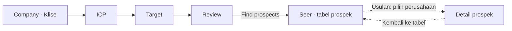

# Kliseer — Design Guide

Terakhir diperbarui: **4 November 2026**.

Pegangan desain UI/UX untuk FigCraft dan handoff frontend. **Acuan visual utama adalah dua gambar dalam folder `reference/` yang ditunjuk pengguna.** Dokumen ini menerjemahkan referensi tersebut ke kebutuhan Kliseer dan mencatat perbedaannya dengan file FigCraft yang sudah ada. Statusnya adalah **baseline desain**, belum persetujuan final untuk semua layar atau implementasi.

## 1. Sumber dan status

| Sumber | Dipakai untuk |
|---|---|
| [ref-1.png](reference/ref-1.png) — gwift | Workspace terang, hierarki teks, sidebar tenang, kartu ringan, dan composer dengan toolbar ringkas |
| [ref-2.png](reference/ref-2.png) — Prompta | Header halaman, kartu membulat, navigasi aktif lavender, selected state ungu, dan composer yang menonjol |
| [sidebar.png](reference/sidebar.png) — referensi sidebar | Sidebar menyatu dengan latar shell, ikon garis per menu, item aktif berupa bidang putih terangkat, pengelompokan menu |
| [Keputusan](docs/decisions.md), terutama D-01, D-12, D-15–D-23 | Nama, navigasi, alur, prioritas, dan keputusan pengguna |
| [Scope](docs/scope.md) | Segmen penjual dan prospek yang dilayani |
| [Brief FigCraft](docs/figcraft-prompt.md) | Rincian layar dan interaksi yang direncanakan |
| [Desain tersimpan](design/kliseer.figcraft) | Snapshot rancangan yang ada; pembanding implementasi terhadap referensi, bukan penentu akhir gaya visual |
| [Data demo](docs/demo.md) | Konteks seller dan contoh ICP; perhatikan status draft |
| [Pertanyaan terbuka](docs/open-questions.md) | Keputusan produk dan data yang belum selesai |

Gunakan tiga status saat membaca dokumen ini:

- **Disepakati:** keputusan pengguna yang sudah tercatat.
- **Teramati:** ciri yang terlihat pada gambar referensi atau nilai yang dibaca dari file FigCraft; asal pengamatan disebutkan. Keberadaan di canvas tidak otomatis berarti sudah disetujui.
- **Usulan:** detail kerja untuk melengkapi desain, masih dapat diubah saat review.

Urutan acuan: **instruksi pengguna terbaru → gambar dalam `reference/` untuk gaya visual → keputusan produk untuk fungsi dan alur → adaptasi dalam dokumen ini → snapshot FigCraft lama**. Referensi tidak mengganti delapan tab atau alur produk yang sudah diputuskan. Nilai ukuran dan warna yang diusulkan dari screenshot bukan spesifikasi resmi produk pada gambar. Beberapa butir lama di `open-questions.md` masih mendahului keputusan desain terbaru.

## 2. Produk dan pengguna

**Kliseer** adalah workspace pencarian prospek untuk supplier atau distributor material dan peralatan pekerjaan bangunan di Amerika Serikat.

Pengguna utamanya adalah **sales rep**, yaitu staf penjualan yang mencari calon pelanggan, memahami kebutuhan mereka, dan menentukan siapa yang layak dihubungi.

Pekerjaan utama pengguna:

1. Menjelaskan perusahaan dan produk yang dijual.
2. Menentukan ICP dan target pasar/prospek.
3. Memeriksa isian yang dibantu oleh chat.
4. Menemukan prospek, membaca alasan relevansi, dan memeriksa sumber pendukung.

ICP berarti **Ideal Customer Profile**: kriteria pelanggan yang cocok. Target mempersempit perusahaan, wilayah, dan peran pembeli yang ingin dicari. Target bukan kuota meeting per bulan.

Prospek mencakup general contractor, specialty trade contractor, system integrator bangunan, serta owner/developer yang membeli peralatan langsung. Pekerjaan sipil berat, pasar di luar AS, dan pengiriman outreach nyata berada di luar scope v1. Semua teks UI menggunakan **English**.

## 3. Arah visual

**Disepakati:** desktop-first dengan workspace terang, sidebar abu-abu muda, area kerja putih, dan aksen ungu. Tabel prospek tetap mudah dipindai, dengan ruang antarelemen yang mengikuti referensi.

### Pembacaan referensi

**ref-1:** sidebar sangat terang; judul gelap dengan deskripsi abu-abu; koleksi kartu tersusun dalam kolom dengan pemisah halus; satu kartu tampak terangkat; ungu muncul pada penanda, pilihan, dan tombol composer. Composer besar berada di bawah dengan toolbar terpisah. Pada gambar ini, navigasi aktif memakai bidang putih dengan border lembut.

**ref-2:** header utilitas tipis berada di atas judul/deskripsi dan aksi halaman. Sidebar aktif memakai latar lavender, ikon/teks ungu, dan penanda di kiri. Kartu memiliki sudut membulat, border ringan, ikon kecil berlatar pastel, dan label metadata. Kartu terpilih memiliki outline ungu, latar lavender yang sangat tipis, serta checkmark. Composer memiliki border ungu dan bayangan yang memisahkannya dari konten.

Kedua gambar adalah contoh **prompt-library workspace**. Adaptasi ke Kliseer mengambil hierarki, material, warna, dan pola kontrolnya; isi halaman tetap mengikuti pekerjaan sales rep. Logo, menu, akun, harga, paket upgrade, fitur template, dan angka dari referensi tidak menjadi requirement Kliseer.

### Penerapan ke Kliseer

| Pola dari referensi | Penerapan yang dituju |
|---|---|
| Shell abu-abu sangat muda dan workspace putih | Sidebar tenang, konten utama putih, pemisah tipis |
| Header utilitas → judul/deskripsi → aksi → filter → isi | Susun header Seer dan layar lain dalam lapisan yang mudah dipindai; search tetap kontekstual |
| Kartu dengan ruang internal dan sudut lembut | Ringkasan Review, metrik Seer, kelompok informasi, dan suggestion chips Home |
| Kartu aktif/terpilih dengan penanda ungu | Navigasi aktif mengikuti ref-2; gunakan border/fill/checkmark sesuai makna selected state |
| Ungu kuat pada aksi, lavender pada latar pilihan | CTA utama jelas, area besar tetap netral |
| Composer berbatas jelas dengan toolbar ringkas | Bentuk input chat mengikuti referensi, ditempatkan dalam konteks Home atau panel kanan |
| Ikon kecil konsisten dan metadata tenang | Ikon navigasi/control sederhana, badge sumber/status berukuran ringkas |

Pedoman kerja:

- Utamakan keterbacaan nama perusahaan, tier, alasan beli, dan sumber.
- Pakai ruang antarkelompok lebih besar daripada jarak isi di dalam satu kelompok. Kepadatan tabel tidak diterapkan ke seluruh halaman.
- Gunakan bentuk membulat secukupnya, border halus, dan bayangan ringan untuk menunjukkan elemen yang terangkat.
- Ungu menandai aksi utama, pilihan aktif, dan fokus; status tetap memiliki label teks.
- Gunakan font sans-serif yang konsisten. Identitas font pada screenshot belum diketahui; jangan mengklaim Inter sebagai font asli referensi.
- Warna solid menjadi baseline. Kilau/gradient kecil yang tampak pada tombol atau logo referensi bersifat opsional; area kerja tetap tenang tanpa gradient besar.
- Tampilkan kekosongan dan kegagalan dengan pesan yang menjelaskan langkah berikutnya.

Koreksi terhadap versi awal: **batas radius 6 px untuk semua elemen dicabut**. Radius, elevasi, dan spacing dibedakan menurut fungsi komponen agar sesuai bentuk panel/kartu yang terlihat pada kedua referensi.

## 4. Navigasi dan layout

### Delapan tab

Urutan sidebar **disepakati** dan tetap sama di seluruh layar.

| Tab | Fungsi | Prioritas desain |
|---|---|---|
| Home | Chat global dan history percakapan yang dikelompokkan per tab | Frame dasar |
| Klise | Background perusahaan; menjadi langkah Company saat setup | Rinci |
| Target | Jenis perusahaan, wilayah, dan peran pembeli yang dicari | Rinci |
| Seer | Tabel prospek dan detail prospek | Rinci |
| Signals | Catatan sinyal, sumber, dan tanggal | Frame dasar |
| Competitors | Daftar atau tabel kompetitor | Frame dasar |
| Profiling | Daftar atau tampilan profil perusahaan | Frame dasar |
| ICP | Kriteria pelanggan ideal | Rinci |

Nama produk selalu **Kliseer**. **Klise** dan **Seer** adalah label tab. Judul isi halaman boleh menjelaskan fungsinya, misalnya `Company background` dan `Prospects`.

### Shell desktop

Ukuran kerja **teramati dari file FigCraft saat ini** (direvisi 4 November 2026), frame **1440 × 900 px**:

| Area | Lebar | Catatan |
|---|---:|---|
| Shell | 1440 px | Latar `#F2F2F4`, padding 8 px, gap antarpanel 8 px |
| Sidebar | 212 px | Menyatu dengan latar shell, tanpa panel sendiri |
| Workspace utama | ±878 px (fill) | Panel putih, radius 12, border `#E5E7EB`, `shadow.surface` |
| Chat kontekstual | 322 px | Panel putih yang sama dengan workspace |

Workspace terdiri dari topbar 52 px (breadcrumb kiri, feedback simpan kanan), konten dengan padding 28/32 px, dan footer aksi 68 px pada layar setup. Form setup dibatasi lebar 640 px. Angka ini titik awal implementasi, bukan kewajiban koordinat absolut.

**Sidebar (mengikuti `reference/sidebar.png`):** logo `K` ungu 28 px dengan wordmark, `Home` berdiri sendiri, tab lain di bawah label `Workspace`. Item 34 px dengan ikon garis 16 px. Item aktif berupa bidang putih, border tipis, shadow kecil, ikon ungu, dan teks Semi Bold. Selama setup, kartu `Setup N of 4` dengan progress bar ada di bawah sidebar. Ini menggantikan latar lavender ref-2 untuk item aktif.

**Adaptasi referensi:** kedua gambar memperlihatkan sidebar kiri dan area konten luas. Kliseer menambahkan panel chat kanan sesuai keputusan produk. Pertahankan rasa lapang melalui padding, hierarki header, dan lebar konten yang fleksibel. Untuk halaman yang membutuhkan pencarian, tempatkan kontrol itu pada header/toolbar tipis; judul dan aksi halaman mendapat baris sendiri. Ini pola penataan, bukan keputusan menambahkan global search atau menu akun baru.

Tiap tab selain Home memiliki satu thread chat kontekstual di kanan, dengan nama seperti `Klise chat` atau `Seer chat`. Home memakai chat global sebagai isi utama dan history per tab; tidak perlu menduplikasi chat di panel kanan.

**Usulan perilaku layout:** workspace mengisi ruang yang tersedia, pesan chat memiliki area scroll sendiri, dan composer tetap mudah dijangkau. Tabel lebar boleh memiliki scroll horizontal di dalam area tabel. Jangan mengecilkan teks untuk memaksakan semua kolom masuk. Adaptasi tablet/mobile dan breakpoint belum ditentukan.

## 5. Alur utama

**Disepakati:** pengguna baru langsung masuk ke Company. Satu langkah ditampilkan per layar, dengan progres dan akses kembali ke langkah yang sudah selesai.

Sidebar tetap terlihat selama setup. Company, ICP, dan Target memakai tab yang sudah ada. Review adalah langkah setup, bukan tab kesembilan.

### Company / Klise

Field dari brief: `Company name`, `Website`, `Products and services`, `Customer segments`, `Existing customers`, `Region`, dan `Price range`.

Tampilkan form yang bisa diedit berdampingan dengan chat. Siapkan contoh kosong, terisi draft, dan tersimpan. Aksi lanjut: `Continue to ICP`. Aturan field wajib dan validasi bisnis belum final; jangan menetapkan semua field sebagai wajib hanya karena tercantum di layout.

### ICP

Kriteria dari brief: industry, company size, region, dan event types. Tampilkan nilai dan statusnya secara jelas. Aksi lanjut menuju Target. Hindari membuat ICP dan Target terasa sebagai dua form identik: ICP menjelaskan kecocokan pelanggan, Target menentukan fokus pencarian.

### Target

Field dari brief: target company types, regions, dan buyer roles. Aksi lanjut menuju Review. Tidak ada langkah Goals terpisah atau field meeting bulanan.

### Review

**Disepakati:** pengguna memeriksa dan menyetujui draft sebelum aksi `Find prospects` membuka Seer.

**Usulan layout, Q20 belum final, sudah dirancang di canvas:** tiga kartu Company, ICP, dan Target, masing-masing berisi tiga field kunci, badge status (`Approved`, `Draft`, `Needs input`), dan link `Edit` di header kartu yang membuka langkah terkait. Bagian berstatus `Draft` memiliki tombol `Approve`. `Find prospects` nonaktif sampai ketiga bagian approved, dengan status tertulis di footer (`2 sections need review`). Field wajib yang kosong tampil merah dengan instruksi singkat. Review hanya menampilkan field kunci; detail lengkap dibuka lewat `Edit`.

### Seer / tabel prospek

Urutan isi dari brief:

1. Judul `Prospects` dan konteks pencarian.
2. Ringkasan `Prospects found`, `Tier S prospects`, dan prospek baru; canvas saat ini memakai label `New this week`.
3. Search perusahaan/domain dan filter `All`, `New this week`, `Tier S`, `Mine`.
4. Tabel prospek sebagai fokus utama.

Informasi tabel: company, domain, tier, reason to buy, contact window, contact role, industry, status, dan source count. **Usulan untuk menjaga lebar:** company dan domain berada dalam satu sel dua baris; kolom lain tetap dapat diakses melalui scroll tabel. Angka rata kanan, teks rata kiri.

Tabel mengambil border halus, header netral, metadata tenang, dan selected state dari bahasa visual referensi. Grid kartu pada screenshot diterapkan pada ringkasan atau kelompok informasi; hasil prospek tetap memakai tabel sesuai keputusan pengguna. Metrik dan toolbar diberi ruang terpisah agar halaman tidak terasa sesak.

Saat discovery berjalan, tampilkan progres per sumber. Bedakan `No prospects yet` dari `No matching prospects` setelah filter. `Retry` ditampilkan pada kegagalan yang bisa dicoba ulang.

Definisi periode prospek baru, cakupan hitungan ringkasan terhadap filter, serta arti kepemilikan pada `Mine` belum final. Angka dalam mockup adalah data contoh, bukan hasil discovery terverifikasi.

### Seer / detail prospek

**Usulan navigasi, Q21 belum final:** pilih perusahaan untuk membuka detail di workspace utama; sidebar dan Seer chat tetap terlihat. Sediakan `Back to prospects`. Usulan ini memakai halaman detail dalam shell, bukan mengunci implementasi ke komponen drawer.

Isi detail dari brief:

- Nama perusahaan, domain, dan tier.
- `Why now`: sinyal, tanggal, jenis, sumber, dan tautan sumber.
- Decision makers: nama, role, sumber, dan confidence jika tersedia.
- Contact window dan konteks alasan beli.

Tampilkan `—` untuk tier yang belum tersedia. Gunakan pesan yang sesuai penyebab: `No signals from connected sources.` untuk belum ada sinyal; `Not enough corroborating signals from connected sources.` hanya jika data memang menyatakan bukti belum cukup. Jangan menyimpulkan aturan scoring dari warna badge.

### Layar pendukung

Home memuat chat global, composer, history per tab, dan tiga suggestion chips pada empty state. Signals menampilkan sinyal per sumber dan tanggal. Competitors dan Profiling cukup memiliki struktur dasar, isi contoh yang jelas, dan tujuan navigasi. Kedalaman desainnya mengikuti D-23.

**Sudah dirancang di canvas (frame dasar, satu state `ready`/`empty`):**

- **Home:** history thread dikelompokkan per tab di kolom kiri dengan tombol `New chat`. Area tengah berisi sapaan, composer besar, dan tiga suggestion card. Tidak ada panel chat kanan, sesuai §4.
- **Signals:** tabel Date, Type (badge), Company, Signal, Source, dengan filter `All / Permits / Hiring / Contracts`. Filter ini usulan.
- **Competitors:** tabel Competitor + domain, Overlapping products, Regions, Positioning, Sources.
- **Profiling:** tabel Company + domain, Type, Employees, Location, Profile (`Complete` / `Partial`), Updated. Status `Partial` dan kolomnya usulan.

## 6. Chat dan draft terstruktur

**Disepakati:** chat mengusulkan nilai field; pengguna tetap memeriksa dan menyetujui hasilnya. Isian dari chat memiliki penanda yang mengarah ke pesan sumber.

**Usulan spesifikasi interaksi:**

- Composer mengambil bentuk dari kedua referensi: panel putih membulat, area ketik yang lega, border netral saat idle, serta outline ungu saat focus. Toolbar berisi hanya aksi yang sudah dipilih untuk Kliseer; ikon attachment atau pengaturan di screenshot bukan otomatis fitur baru.
- Pada Home, composer dapat menjadi bagian utama area chat. Di tab lain, letakkan composer di bagian bawah panel kanan. Posisi melayang menutupi grid pada referensi tidak diterapkan di atas tabel Seer karena akan menutup data.
- Bedakan status `Draft`, `Approved`, dan feedback penyimpanan `Saved`. Tersimpan tidak otomatis berarti disetujui.
- Field tetap dapat diedit langsung. Draft baru tidak menimpa edit manual tanpa tindakan pengguna yang jelas.
- Aksi sumber, misalnya `From chat`, membuka atau menyorot pesan terkait.
- Jika pengguna mengubah nilai setelah approval, tunjukkan bahwa bagian itu perlu direview lagi.
- Loading chat tidak menghilangkan nilai form. Error pengiriman mempertahankan pesan agar bisa dicoba ulang.
- Pertanyaan chat mengikuti konteks seller: supplier menjual kepada pembeli proyek bangunan. Jangan mengasumsikan pembelinya selalu supplier lain.

## 7. Design tokens

### Palet yang dituju dari referensi

Nilai berikut adalah **usulan token untuk menerjemahkan kedua referensi**. Screenshot memperlihatkan putih, abu-abu sangat terang, lavender, dan ungu yang lebih kuat daripada ungu pada canvas lama. Pemeriksaan sampel piksel menemukan bidang dominan `#FFFFFF` dan `#F8F8F8` pada ref-1, serta `#FFFFFF`, `#FAFAFA`, dan `#EFF1F7` pada ref-2. Warna tombol bervariasi di dalam gambar; hex aksi di bawah adalah warna solid yang dinormalisasi untuk Kliseer, bukan klaim token asli referensi.

| Token semantic | Nilai | Pemakaian |
|---|---|---|
| `surface.app` | `#EFF1F7` | Latar luar bila shell ditampilkan sebagai panel |
| `surface.canvas` | `#FFFFFF` | Workspace, kartu, dan panel chat |
| `surface.sidebar` | `#F8F8F8` | Sidebar terang, mengikuti ref-1 |
| `surface.subtle` | `#F6F8FA` | Toolbar, header tabel, dan latar segmented control |
| `surface.chat-message` | `#FAF7FF` | Latar pesan atau pilihan lembut |
| `text.primary` | `#202431` | Judul halaman |
| `text.label` | `#434A57` | Label field |
| `text.secondary` | `#5F6673` | Navigasi nonaktif |
| `text.muted` | `#666D7A` | Deskripsi pendukung; digelapkan dari `#6B7280` agar ≥4.5:1 di atas shell `#F2F2F4` dan bubble `#F5F0FF` |
| `text.placeholder` | `#666D7A` | Placeholder; tetap sediakan label field |
| `text.brand` | `#302B49` | Wordmark Kliseer |
| `action.primary` | `#6D28D9` | Tombol utama, mendekati ungu dominan ref-2 |
| `action.primary-hover` | `#5B21B6` | State hover yang lebih gelap |
| `action.on-primary` | `#FFFFFF` | Teks dan ikon pada tombol ungu |
| `navigation.active-text` | `#6D28D9` | Teks/ikon navigasi aktif |
| `navigation.active-bg` | `#F3ECFF` | Latar lavender seperti ref-2 |
| `selection.background` | `#FDFAFF` | Isi kartu terpilih yang sangat tipis |
| `selection.border` | `#8B5CF6` | Outline pilihan; sertakan penanda teks/ikon |
| `focus.ring` | `#6D28D9` | Fokus keyboard pada kontrol |
| `border.default` | `#E5E7EB` | Pemisah panel |
| `border.input` | `#DADDE5` | Field dan composer |
| `border.row` | `#EDF0F3` | Pemisah baris tabel |

Token warna sudah dibuat sebagai variables di FigCraft, collection `Kliseer tokens` (41 variable warna, satu mode), dan diikat ke semua fill dan stroke di halaman `Screens`. Nama di FigCraft memakai slash (`action/primary`, `text/muted`, `tier/A-bg`) dan diekspor ke `design/tokens.css` sebagai custom property (`--action-primary`). Tambahan untuk state: `action/primary-hover` `#5B21B6`, `navigation/hover-bg` `#E9E9EE`, dan `focus/ring` `#6D28D9`.

**Perbedaan terhadap snapshot FigCraft lama:** `action.primary` lama `#6654CE`, sidebar `#F7F8FA`, active background `#EEEAFE`, active text `#5E4BC6`, dan placeholder `#9298A3`. Nilai lama dicatat untuk melacak perubahan; implementasi visual berikutnya mengikuti palet yang dituju di atas.

### Tier — baseline produk, bukan salinan referensi

Gambar referensi tidak mendefinisikan tier S/A/B/C. Nilai berikut berasal dari canvas Kliseer dan dipertahankan sebagai baseline badge produk, dengan warna status lembut yang selaras dengan referensi.

| Label | Background teramati | Teks teramati |
|---|---|---|
| S | `#E8F5EE` | `#207B55` |
| A | `#EAF2FC` | `#2868A8` |
| B | `#FFF3E0` | `#A05F11` |
| C | `#F0F1F4` | `#686C78` |
| `—` | `#F0F1F4` | `#686C78` |

Badge pada canvas berukuran 26 × 24 px dengan radius 6 px. C dan `—` boleh berbagi warna netral, tetapi label dan penjelasan harus membedakan tier C dari data yang belum tersedia. Aturan tier S/A/B/C dan pemetaannya ke temperature engine masih belum diputuskan. Teks S, B, dan C digelapkan dari nilai canvas lama (`#23835B`, `#A96512`, `#737784`) agar lolos 4.5:1.

**Hasil cek kontras (WCAG 2.1, rumus luminans relatif, dihitung dari hex token; belum diuji dengan alat bantu atau pengguna):**

| Pasangan | Rasio | Status |
|---|---:|---|
| `text/muted` di atas canvas / shell / table header / bubble | 4.66–5.0 | Lolos 4.5:1 setelah diperbaiki |
| Tier S / A / B / C | 4.63 / 5.12 / 4.65 / 4.64 | Lolos setelah diperbaiki |
| Putih di atas `action/primary` | 7.10 | Lolos |
| Teks disabled `#6B5FA0` di atas `#EDE9FE` | 4.69 | Lolos (disabled tidak wajib, tetap terbaca) |
| `status/error` di atas canvas | 6.57 | Lolos |
| Border input `#DADDE5` di atas putih | 1.36 | **Gagal 3:1 untuk batas komponen (1.4.11).** Belum diubah; label field selalu terlihat, tetapi batas input lemah. Opsi: border `#8F9197` (3.05:1) atau terima dengan alasan label |

### Tipografi, spacing, dan ukuran

Font **teramati pada file FigCraft:** Inter, dengan Regular, Medium, Semi Bold, dan Bold. Inter tidak terpasang di mesin desain; file variable font disimpan di `design/fonts/Inter-Variable.ttf` (OFL, dari `google/fonts`) dan dimuat per sesi FigCraft lewat `text.loadFont`. Tanpa langkah itu, teks dirender dengan font pengganti dan kotak teks bergeser (terpotong, label tombol tidak center). Pasang Inter di sistem agar permanen. Identitas font pada gambar referensi tetap tidak dapat dipastikan. Teks 10–11 px tidak dijadikan standar body.

**Usulan skala yang dirapikan untuk komponen reusable:**

| Peran | Ukuran / line height | Weight |
|---|---|---|
| Page title | 24 / 32 px | 600 |
| Section heading | 16 / 24 px | 600 |
| Body, field value, navigasi | 14 / 20 px | 400–600 |
| Metadata, label, badge | 12 / 16 px | 400–600 |

Gunakan angka tabular untuk hitungan dan tanggal. **Usulan spacing:** 4, 8, 12, 16, 24, dan 32 px; gap kartu 12–16 px, padding kartu 16–20 px, jarak kelompok 24–32 px, dan padding workspace 24–32 px. Pertahankan ruang internal kartu seperti pada kedua referensi. Angka ini adalah skala kerja, bukan pengukuran persis gambar.

**Usulan radius dan elevasi yang mengikuti bentuk referensi:**

| Token / elemen | Nilai kerja | Tujuan |
|---|---|---|
| `radius.control` | 6 px | Input, tombol ringkas, item navigasi |
| `radius.card` | 10 px | Kartu metrik, ringkasan, dan kelompok informasi |
| `radius.composer` | 12 px | Composer dan panel mengambang |
| `radius.shell` | 16 px | Shell luar bila memakai inset; opsional untuk web app penuh |
| Badge / chip | 4–6 px | Label kecil; avatar dapat berbentuk lingkaran |
| `shadow.surface` | `0 1px 3px rgba(20, 20, 40, 0.06)` | Elevasi ringan pada kartu/segmen yang perlu dibedakan |
| `shadow.floating` | `0 8px 24px rgba(20, 20, 40, 0.12)` | Composer melayang atau overlay |

Kartu biasa cukup memakai border tipis; bayangan lebih jelas dipakai pada elemen yang terangkat seperti di ref-1. Selected state mengikuti outline/fill pada ref-2. Shadow tidak diterapkan ke setiap sel atau baris tabel. Ikon navigasi/control memakai gaya outline konsisten dengan ukuran kerja 16–18 px; ikon dalam kartu boleh memakai wadah pastel kecil.

Ukuran kontrol **sudah dinormalisasi di canvas:** input 40 px (textarea 88 px), tombol utama 40 px, tombol sekunder 36 px, search 36 px, segmented filter 28 px di dalam wadah 3 px, item navigasi 34 px, dan baris tabel minimum 60 px yang bertambah saat teks membungkus. Radius yang dipakai: 8 px untuk input, tombol, dan item navigasi; 6 px untuk badge, chip, dan segmen filter; 10 px untuk kartu dan tabel; 12 px untuk panel dan composer. Nilai ini menggantikan `radius.control` 6 px di tabel atas untuk kontrol berukuran 36–40 px.

### Struktur token

Gunakan tiga lapisan saat token dibuat:

| Lapisan | Contoh |
|---|---|
| Primitive: nilai dasar | `purple.600 = #6D28D9` |
| Semantic: tujuan | `action.primary → purple.600` |
| Component: pemakaian | `button.primary.background → action.primary` |

Pakai nama semantic yang sama di catatan FigCraft dan frontend. Simpan nilai final di satu sumber token setelah review; jangan menyebarkan hex yang sama ke setiap komponen secara terpisah.

## 8. Komponen dan state

Spesifikasi berikut adalah **usulan komponen reusable** berdasarkan kebutuhan brief.

| Komponen | Varian / state | Aturan utama |
|---|---|---|
| App shell | Setup, workspace, Home | Navigasi konsisten; Home memiliki susunan chat sendiri |
| Sidebar item | Default, hover, active, focus | Ikon + label; active memakai lavender, teks ungu, dan penanda kiri seperti ref-2 |
| Header dan toolbar | Title, description, contextual actions, search/filter bila relevan | Hierarki mengikuti kedua referensi; pisahkan judul dari kontrol pencarian |
| Summary card | Default, hover bila interaktif, selected bila dapat dipilih | Radius 10 px, border halus, padding lega; outline ungu hanya jika status selected bermakna |
| Setup stepper | Current, completed, upcoming | Langkah selesai dapat dikunjungi kembali |
| Button | Primary, outline, ghost; hover, pressed, focus, disabled, loading | Satu aksi utama dominan per langkah; loading tidak mengubah lebar tombol |
| Form field | Empty, filled, draft, approved, error, disabled | Label tetap terlihat; bantuan, error, dan sumber berada dekat field |
| Chat panel | Empty, populated, sending, error | Identitas thread jelas; composer membulat dan outline focus mengikuti referensi |
| Summary metric | Loading, value, unavailable | Nilai tidak diketahui memakai `—`, bukan otomatis nol |
| Prospect table | Loading, populated, empty, filtered-empty, error | Identitas perusahaan dan aksi membuka detail mudah ditemukan |
| Tier badge | S, A, B, C, unavailable | Label teks wajib; tidak menghitung tier di lapisan tampilan |
| Source reference | Available, missing | Tautan menunjuk sumber yang tersedia; jangan membuat URL contoh seolah terverifikasi |
| Feedback | Saved, error, retry | Dekat aksi/field; pesan penting tidak hanya muncul sesaat |

**State minimum untuk alur utama:** Company, ICP, dan Target memiliki empty, draft-filled, loading, error, dan saved. Review memiliki ready dan contoh informasi belum lengkap. Tabel Seer memiliki loading, populated, empty, filtered-empty, dan error. Detail memiliki ready, loading, error, dan contoh bukti tidak tersedia. `Saved` pada detail hanya relevan jika ada aksi edit/simpan yang nantinya dipilih.

Untuk prototipe awal, frame dasar layar pendukung cukup mengikuti prioritas D-23; varian state pendukung dapat menyusul setelah alur utama jelas.

## 9. Keterbacaan dan interaksi

Target review desain, belum klaim hasil pengujian:

- Semua kontrol bisa dicapai dengan keyboard dan memiliki penanda fokus.
- Label field tidak bergantung pada placeholder; error menjelaskan cara memperbaiki isian.
- Nama perusahaan dapat menjadi link detail yang jelas, selain klik baris.
- Status, approval, dan tier dapat dipahami tanpa warna.
- Teks panjang membungkus atau memiliki cara membaca isi lengkap, tanpa menutupi kontrol.
- Kontras token sudah dihitung (§7). Sisa: border input dan pengujian dengan alat bantu nyata.
- Setelah berpindah layar atau muncul error, fokus diarahkan ke judul atau masalah yang relevan.
- Transisi tidak menghalangi pekerjaan; sediakan perilaku reduced motion saat animasi ditambahkan.

**Disepakati:** Anime.js/Three.js baru dipertimbangkan setelah struktur dan interaksi stabil. Prototipe pertama berfokus pada navigasi, pengisian form, review, dan pembacaan prospek.

## 10. Status file FigCraft dan handoff

Pemeriksaan file pada 4 November 2026: `design/kliseer.figcraft` sebelumnya **tidak ditemukan** di repo, sehingga file dibuat ulang dari nol dengan acuan referensi dan dokumen ini. Halaman `Screens` berisi 30 frame 1440 × 900 px; halaman `Components` berisi komponen reusable:

| Kelompok | Frame | Keterangan |
|---|---|---|
| Setup | `setup/company/{empty,draft,loading,error,saved}` | Tab aktif Klise; error = Website tidak valid |
| Setup | `setup/icp/{empty,draft,loading,error,saved}` | Error = Company size bukan rentang |
| Setup | `setup/target/{empty,draft,loading,error,saved}` | Error = gagal simpan, banner dengan `Retry` |
| Setup | `setup/review/{ready,incomplete}` | Incomplete = ICP `Needs input`, Target `Draft` |
| Seer | `seer/table/{ready,loading,empty,filtered-empty,error}` | Tab aktif Seer; loading menampilkan progres per sumber |
| Seer | `seer/detail/{ready,loading,error,unavailable}` | Unavailable = Ironbound, tier `—`, satu sinyal dengan `Not enough corroborating signals from connected sources.`, decision makers dan contact window kosong |
| Tab dasar | `home/chat/empty`, `signals/list/ready`, `competitors/list/ready`, `profiling/list/ready` | Dibangun dari komponen; data mockup |

Pola state di setup: `Draft`, `Drafting…`, `Not saved`, dan `✓ Saved` di topbar; titik ungu di samping label field menandai nilai `From chat`, dengan satu legenda di header halaman. Topbar Seer memiliki label `Sample data` karena semua perusahaan, domain `.example`, kontak, dan angka adalah data mockup.

**Interaksi prototipe yang tersambung (±300 link, transisi dissolve 200 ms):**

- `Continue to …` dari state draft: Company → ICP → Target → Review ready.
- `Back` dan langkah selesai di stepper membuka langkah terkait dalam state saved.
- `Edit` di kartu Review dan `Back` di Review membuka langkah terkait.
- `Find prospects` membuka `seer/table/loading`, yang berpindah otomatis ke `seer/table/ready` setelah 1,5 detik.
- Baris Northgate membuka detail ready; baris Ironbound membuka detail unavailable. `Back to prospects` kembali ke tabel. Detail loading berpindah otomatis ke ready setelah 1,5 detik; `Retry` di detail error kembali ke loading.
- `Approve` di Review incomplete membuka Review ready (pintasan prototipe; approval per bagian belum dimodelkan).
- Semua delapan menu sidebar di semua frame membuka tab terkait: Home, Company saved (Klise), Target saved, tabel Seer, Signals, Competitors, Profiling, dan ICP saved.
- Di Home, suggestion card membuka Seer, Signals, dan Company; thread history membuka tab asalnya.
- `Retry` di error kembali ke loading; `Clear filters` ke tabel; `Edit setup` di Seer membuka Review.

**Komponen dan style (halaman `Components`):**

| Komponen | Varian / properti |
|---|---|
| `button` | `Kind` Primary/Outline/Ghost, `State` Default/Disabled; teks `Label` |
| `nav/item` | `State` Default/Active; teks `Label`; instance swap `Icon` (8 komponen `icon/*`) |
| `tier/badge` | `Tier` S/A/B/— |
| `status/badge` | `Status` Approved/Draft/Needs input/Neutral; teks `Label` |
| `field/text` | `State` Default/Error; teks `Label`, `Value`, `Error` |
| `field/chips`, `chat/composer`, `setup/progress` | Komponen tunggal |
| `chat/message` | `Role` Assistant/User; teks `Text` |

Text style: `Page title`, `Section heading`, `Body`, `Body strong`, `Label`, `Metadata`.

Frame lama di `Screens` belum ditukar menjadi instance; layer-nya tetap lepas tetapi warnanya sudah terikat ke variables. Frame Home, Signals, Competitors, dan Profiling sudah memakai instance `nav/item`, `button`, `status/badge`, `chat/message`, dan `chat/composer`.

**Hover dan focus (varian komponen):** `button` punya `State` Hover dan Focus untuk Primary, Outline, dan Ghost; `nav/item` punya Hover dan Focus; `field/text` punya Focus. Focus ring berupa outline 2 px `focus/ring` di luar komponen (pada field: border 1.5 px ungu dengan halo tipis). Varian ini ada di halaman `Components`; frame di `Screens` tetap menampilkan state default.

Belum ada: variables untuk radius dan spacing, dan state loading/empty/error untuk empat tab dasar. Pemilihan state tujuan `Edit` saat implementasi (draft atau saved) belum ditentukan.

### Selisih yang perlu dibawa ke revisi FigCraft

| Bagian | Temuan pada baseline lama | Arah setelah memeriksa referensi |
|---|---|---|
| Acuan visual | Nilai canvas menjadi patokan utama | Kedua gambar di `reference/` menjadi acuan visual utama |
| Ungu | `#6654CE`, relatif lebih redup | Usulan solid `#6D28D9`, lavender untuk pilihan |
| Radius | Brief lama membatasi semua elemen hingga 6 px | 6 px kontrol, 10 px kartu, 12 px composer; nilai kerja per fungsi |
| Kepadatan | Instruksi compact berlaku terlalu luas | Tabel ringkas, kartu dan kelompok isi tetap lapang |
| Elevasi | Border menjadi pembeda dominan | Border halus + shadow terarah pada permukaan terangkat |
| Header | Fokus judul dan isi halaman | Lapisan toolbar, judul/deskripsi/aksi, filter, lalu isi |
| Composer | Field sederhana di panel kanan | Bentuk composer referensi diadaptasi ke Home/panel kanan sesuai alur Kliseer |

Sebagian besar selisih di atas sudah diterapkan pada file yang dibuat ulang: ungu `#6D28D9`, radius per fungsi, tabel ringkas dengan kartu lapang, border + shadow terarah, header berlapis, dan composer satu baris dengan tombol kirim.

Paket handoff:

1. File `.figcraft` yang disimpan setelah review: `design/kliseer.figcraft`.
2. Export PNG: `design/export/` berisi 30 frame (nama file = nama frame dengan `/` menjadi `-`, skala 1×) dan `components.png` (skala 2×). Token CSS: `design/tokens.css`.
3. Daftar token final, ukuran komponen, dan contoh state.
4. Peta interaksi: stepper, edit dari Review, Find prospects, detail, dan kembali ke tabel.
5. Catatan konten/data yang masih contoh atau belum diputuskan.

React atau Next.js ditentukan setelah desain disetujui. Pilihan Vite, Tailwind, shadcn/ui, icon library, dan library tabel dalam brief sebelumnya masih usulan. Handoff harus cukup jelas untuk diimplementasikan sebagai komponen yang responsif tanpa bergantung pada koordinat absolut canvas. Ekspor token JSON khusus belum diverifikasi; catatan token manual tetap dapat dipakai.

## 11. Keputusan yang masih terbuka

- Bentuk Review dan mekanisme approval rinci (Q20).
- Navigasi detail prospek: usulan saat ini menggunakan workspace utama (Q21).
- Aturan tier S/A/B/C dan hubungan dengan temperature engine.
- Field wajib, validasi, dan aturan penyimpanan draft.
- Definisi `Mine`, periode prospek baru, dan cakupan angka ringkasan.
- Desain tablet/mobile, breakpoint, serta perilaku panel pada layar sempit.
- Persetujuan token final, normalisasi ukuran kontrol, dan pemeriksaan kontras.
- Framework frontend, library pendukung, serta cakupan animasi berikutnya.
- Pilihan data nyata/sintetis untuk demo, sesuai pertanyaan produk yang sudah tercatat.

## 12. Checklist siap implementasi

- [ ] Urutan delapan tab dan penamaan Kliseer/Klise/Seer konsisten.
- [ ] Frame dibandingkan berdampingan dengan `reference/ref-1.png` dan `reference/ref-2.png` untuk shell, header, warna, radius, spacing, kartu, dan composer.
- [ ] Nilai token dan ukuran usulan dibedakan dari pengamatan screenshot serta snapshot canvas lama.
- [ ] Alur Company → ICP → Target → Review → Seer bisa diklik sampai selesai.
- [ ] Pengguna bisa kembali mengedit langkah yang selesai.
- [ ] Draft chat, sumber pesan, approval, dan feedback penyimpanan dapat dibedakan.
- [ ] Tabel tetap terbaca dengan chat terbuka dan nama perusahaan panjang.
- [ ] Detail prospek dan navigasi kembali memiliki desain yang disepakati.
- [ ] Empty, loading, error, dan data tidak tersedia memiliki contoh yang jelas.
- [ ] Tier dan sumber tidak mengesankan bukti atau aturan scoring yang belum ada.
- [ ] Angka dan perusahaan contoh jelas ditandai sebagai data mockup bila belum terverifikasi.
- [ ] Token, ukuran komponen, focus state, dan kontras sudah direview.
- [ ] Frame, export, dan catatan interaksi cocok dengan versi desain yang disetujui.

Checklist ini adalah kriteria handoff berikutnya, bukan pernyataan bahwa prototipe sekarang sudah lengkap.
